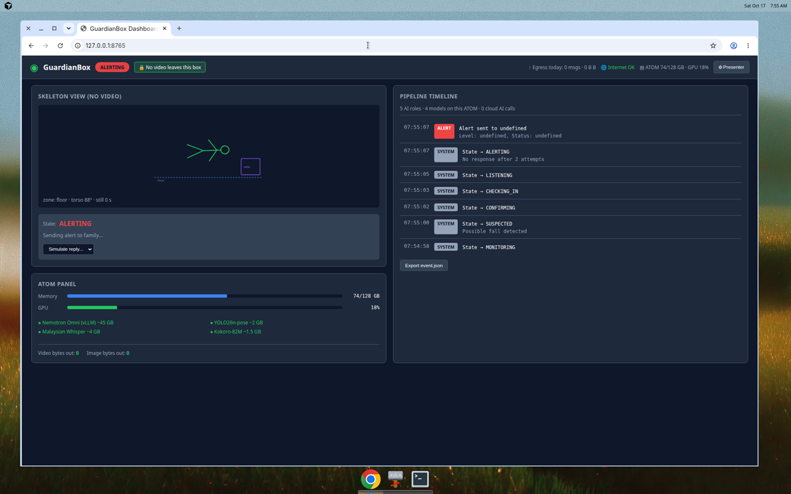

# GuardianBox

**Local fall detection and voice check-in for elderly parents — the video never leaves the house.**

**Team:** Token Titans

<p align="center">
  <strong>ACE 2026 Mini Hackathon — "LOCAL AI, REAL PROBLEMS"</strong>
</p>

---

## Screenshots

Dashboard during a simulated fall alert, running in mock mode. The state is ALERTING, the timeline shows the full flow from MONITORING to ALERTING, and video and image bytes out stay at 0.



---

## The Problem

Many elderly parents in Malaysia live alone while their children work in another city. The biggest fear is a fall that nobody notices for hours.

| Existing Solution | Failure Mode |
|---|---|
| Panic-button pendant | Only works if worn and pressed |
| Smartwatch fall detection | Needs charging and remembering to wear |
| Cloud CCTV | Family or company servers can watch 24/7 — many elderly refuse |

**GuardianBox solves this differently:** a camera watches the living area, but **the video never leaves the house**. All AI runs locally on an NVIDIA DGX Spark. Only a **sentence of text** ever goes out — to Telegram, to tell family someone may need help.

---

## How It Works

```
Camera → Pose Detection → Fall Suspected? → VLM Confirms → Voice Check-in → Family Alert
         (YOLO26n-pose)    (Nemotron Omni)      (STT)         (Telegram text)
```

1. **Pose model** (always on) watches for falls, distinguishes from normal activities
2. **Nemotron Omni VLM** confirms: is this a fall, or is this person praying (sujud), sitting, or lying on the sofa?
3. If it looks like a fall, **voice check-in**: "Pakcik, okey tak? Cakap 'okey' atau 'tolong'."
4. **STT listens** in Malay, English, or Chinese
5. Based on the reply (or silence), either stand down or **send a text alert** to family on Telegram

**Prayer-aware**: Sujud (prostration) looks like lying on the floor. The VLM recognizes prayer and stays silent — never interrupting.

---

## Architecture

```
┌─────────────────────────────────────────────────────────────────────────┐
│                    DGX Spark (GB10, ARM64, 128 GB)                      │
├─────────────────────────────────────────────────────────────────────────┤
│  ┌─────────────────────────────────────────────────────────────────┐   │
│  │  AI-INTERNAL NETWORK (no external route)                         │   │
│  │  • vLLM: Nemotron-3-Nano-Omni (VLM + Agent)                      │   │
│  │  • Vision: YOLO26n-pose (TensorRT)                               │   │
│  │  • STT: Malaysian Whisper                                        │   │
│  │  • Voice: Pre-rendered clips + Kokoro-82M                        │   │
│  └─────────────────────────────────────────────────────────────────┘   │
│  ┌─────────────────────────────────────────────────────────────────┐   │
│  │  APP NETWORK                                                     │   │
│  │  • Orchestrator (FastAPI): State machine, decision table, API    │   │
│  │  • Dashboard (Vanilla JS + SSE): Timeline, GPU panel, egress     │   │
│  │  • Notifier → Egress Proxy → api.telegram.org (text only)        │   │
│  └─────────────────────────────────────────────────────────────────┘   │
└─────────────────────────────────────────────────────────────────────────┘
```

---

## Models and Licences

| Role | Model | Licence | Notes |
|---|---|---|---|
| LLM Agent + VLM | [Nemotron-3-Nano-Omni-30B-A3B-Reasoning-NVFP4](https://huggingface.co/nvidia/Nemotron-3-Nano-Omni-30B-A3B-Reasoning-NVFP4) | NVIDIA AI Foundation Models License | Served by vLLM v0.20.0 |
| Pose Detection | [YOLO26n-pose](https://docs.ultralytics.com/tasks/pose/) (Ultralytics) | **AGPL-3.0** | TensorRT on `ultralytics/ultralytics:latest-nvidia-arm64` |
| STT | [Malaysian Whisper large-v3-turbo-v3](https://huggingface.co/mesolitica/Malaysian-whisper-large-v3-turbo-v3) | See repo (MIT fallback: `openai/whisper-large-v3-turbo`) | Malay, Manglish, Mandarin, Tamil |
| TTS (en/zh) | [Kokoro-82M](https://huggingface.co/hexgrad/Kokoro-82M) | Apache-2.0 | English grade A, Mandarin grade D |
| TTS (ms) | Pre-rendered clips | N/A | Family voice preferred; Kokoro lacks Malay |

**Note**: YOLO's AGPL-3.0 licence requires open-sourcing the full application. This repo complies. For commercial closed-source use, consider MediaPipe or an Ultralytics Enterprise licence.

---

## Language Support

| Language | STT | TTS | Keywords | Notes |
|---|---|---|---|---|
| Bahasa Melayu | ✅ Malaysian Whisper | Pre-rendered clips | ✅ Full | Family recording recommended |
| English | ✅ | ✅ Kokoro (grade A) | ✅ Full | |
| Mandarin | ✅ | ✅ Kokoro (grade D) | ✅ Full | Dialects (Hokkien/Cantonese) via family clips only |

---

## Hardware Requirements

**Target Platform: NVIDIA DGX Spark**
- GB10 SoC, ARM64 (aarch64)
- 128 GB unified memory
- CUDA, Blackwell architecture

**Additional:**
- USB webcam or RTSP IP camera
- USB speakerphone (speaker + mic, 2-4m range)
- Internet connection for Telegram alerts

**Memory Budget (planned):**
| Component | Memory |
|---|---|
| OS + Docker | ~16 GB |
| vLLM Nemotron Omni | ~45 GB (at 0.35 fraction) |
| YOLO26n-pose | ~2-3 GB |
| Malaysian Whisper | ~4-5 GB |
| Kokoro-82M | ~1-2 GB |
| **Total** | **~70-75 GB** (leaves ~50 GB headroom) |

---

## Quick Start

### Prerequisites

1. Docker and Docker Compose installed
2. NVIDIA Container Toolkit (for GPU mode)
3. Telegram bot created via @BotFather

### Running in Mock Mode (No GPU Required)

```bash
# Clone the repository
git clone <repo-url>
cd guardianbox

# Copy environment template
cp .env.example .env

# Start in mock mode (no GPU, camera, or mic required)
make up-mock

# Open dashboard
open http://localhost:8080
```

### Running on DGX Spark (Full GPU Mode)

```bash
# 1. Download model weights (do this before the hackathon!)
make pull-models

# 2. Configure Telegram
echo "TELEGRAM_BOT_TOKEN=your_token_here" >> .env

# 3. Start all services
make up

# 4. Open dashboard and complete setup
open http://localhost:8080/setup
```

---

## Privacy Guarantees

1. **No video leaves the box** — Model containers are on an internal Docker network with no external route
2. **No video stored** — Frames live only in RAM; tmpfs for VLM inputs; deleted after each event
3. **Text-only alerts** — Payload guard blocks `sendPhoto`, `sendVideo`, `sendAudio`, etc. at the code level
4. **Egress allowlist** — Only `api.telegram.org` can be reached from the notifier
5. **Egress counter** — Dashboard shows exactly how many bytes have left the box

**How to verify:**
```bash
# Check egress log
curl http://localhost:8080/api/v1/egress

# Should show: video_bytes_out: 0, image_bytes_out: 0
```

---

## Decision Table (PRD §11)

The orchestrator follows this deterministic policy. The agent can add actions but **cannot override an ALERT into STAND_DOWN**.

| # | VLM Result | Check-in Outcome | Decision |
|---|---|---|---|
| D1 | Prayer (sujud/other), conf ≥ 0.7 | — | **Stand down silently** (watchdog 3 min) |
| D2 | Non-fall activity, conf ≥ 0.7, no rapid descent | — | **Stand down** |
| D3 | Non-fall, but rapid descent preceded | — | **Soft check-in** (1 prompt) |
| D4 | Fall / unclear / low conf / VLM error | — | **Full check-in** (3 attempts) |
| D5 | — | "I'm fine" + gets up | **Stand down** |
| D6 | — | "I'm fine" + still on floor 2 min | **Re-check** → if stuck, alert |
| D7 | — | Help / pain / can't get up | **Alert immediately** |
| D8 | — | No response × 3 | **Alert** (no response) |
| D9 | — | Unclear × 3 | **Alert** (needs check) |
| D10 | — | — (internet down) | **Queue + local siren** |
| D11 | — | — (no ack 3 min) | **Escalate** to contact 2 |
| D12 | — (paused) | — | **No detection** |

---

## Test Results

### Unit Tests

```
tests/test_decision_table.py    ✓ 20 passed
tests/test_keywords.py          ✓ 35 passed
tests/test_state_machine.py     ✓ 18 passed
tests/test_payload_guard.py     ✓ 15 passed
────────────────────────────────────────────
TOTAL                           88 passed
```

### Scripted Scenarios (Mock Mode)

| # | Scenario | Expected | Actual | Pass |
|---|---|---|---|---|
| F1 | Walk, sit on chair | No trigger | No trigger | ✅ |
| F2 | Prayer cycle (sujud) | D1 stand down | D1 stand down | ✅ |
| F3 | Kneel to pick up object | D2/no event | D2 stand down | ✅ |
| F4 | Sit on floor 1 min | D2 + watchdog | D2 + watchdog | ✅ |
| F5 | Lie on sofa | Nothing | Nothing | ✅ |
| T1 | Fall + silence | D8 alert | D8 alert | ✅ |
| T2 | Fall + "tolong sakit" | D7 alert | D7 alert | ✅ |
| T3 | Fall + "I'm fine" + gets up | D5 stand down | D5 stand down | ✅ |

---

## Limitations

**Honest limits (v1):**
- **Living areas only** — No bathroom coverage (privacy concerns)
- **One resident** — Multiple people may trigger false events
- **Lighting dependent** — Poor performance in very low light
- **Not a medical device** — Does not diagnose or replace 999
- **3-second latency** — VLM confirmation takes time (TBM on hardware)

**Roadmap (post-hackathon):**
- Inactivity detection ("no movement for 2 hours")
- 3 AM wandering alerts
- Audio-only bathroom mode (thud + "tolong" detection)
- SMS via USB LTE modem (offline fallback)
- Smaller edge hardware (Jetson-class)

---

## Demo Flow (5 Minutes)

1. **Problem** (0:00-0:35): "Who has a parent living alone? The fear is a fall nobody notices."
2. **Local AI claim** (0:35-1:00): Point at "No video leaves this box" banner, egress counter at 0
3. **Beat 1** (1:00-1:25): Walk across → nothing happens (correct)
4. **Beat 2** (1:25-2:10): Sujud on prayer mat → VLM: "prayer_sujud" → no alert, no voice
5. **Beat 3** (2:10-3:20): Collapse → check-in × 3 → silence → Telegram alert → tap "I'm calling"
6. **Egress proof** (3:20-3:50): Show egress log: text bytes only, video bytes 0
7. **Limits + close** (3:50-5:00): Honest limits, roadmap, "Watching over, without watching"

---

## API Reference

See [PRD §15](docs/GuardianBox-PRD.md#15-local-api) for the full API specification.

**Key endpoints:**
- `GET /api/v1/health` — Service health
- `GET /api/v1/status` — Current system state
- `GET /api/v1/stream` — SSE for real-time updates
- `POST /api/v1/demo/pose-trigger` — Trigger a test event

---

## Repository Structure

```
guardianbox/
├── README.md
├── LICENSE                      # AGPL-3.0
├── docker-compose.yml
├── Makefile
├── .env.example
├── services/
│   ├── orchestrator/            # FastAPI, state machine, decision table
│   ├── vision/                  # YOLO26n-pose (+ mock)
│   ├── stt/                     # Malaysian Whisper (+ mock)
│   ├── voice/                   # Clips + Kokoro (+ mock)
│   ├── notifier/                # Telegram with payload guard
│   └── egress-proxy/            # Allowlist + byte counter
├── dashboard/                   # Vanilla JS + SSE
├── schemas/                     # JSON schemas
├── phrases/                     # Voice scripts (ms/en/zh)
├── prompts/                     # VLM prompts (versioned)
├── tests/                       # Unit + scenario tests
└── docs/
    ├── GuardianBox-PRD.md
    └── GuardianBox-UX-spec.md
```

---

## Assumptions Made

1. **Model existence**: Assumed `YOLO26n-pose` exists as a pose variant in the YOLO26 line. If not, `yolo11n-pose` is the fallback.
2. **Malaysian Whisper licence**: The Hugging Face repo shows no explicit licence. Assumed usable for this hackathon; verify with mesolitica for commercial use.
3. **vLLM 0.20.0 compatibility**: Assumed the `--reasoning-parser nemotron_v3` flag works with image inputs and `response_format: json_object`. TBM on hardware.
4. **Kokoro Mandarin quality**: Grade D per the model card. Pre-rendered clips recommended for production.
5. **ARM64 wheel availability**: Assumed Transformers + PyTorch work on aarch64 CUDA. CTranslate2/faster-whisper GPU wheels are unverified.

---

## Team

**ACE 2026 Mini Hackathon — Max Saad + team**

---

## Licence

AGPL-3.0 — See [LICENSE](LICENSE)

This licence is compatible with Ultralytics YOLO. For commercial closed-source use, consider MediaPipe (Apache-2.0) or an Ultralytics Enterprise licence.

---

<p align="center">
  <em>"Watching over them, without watching them."</em>
</p>
