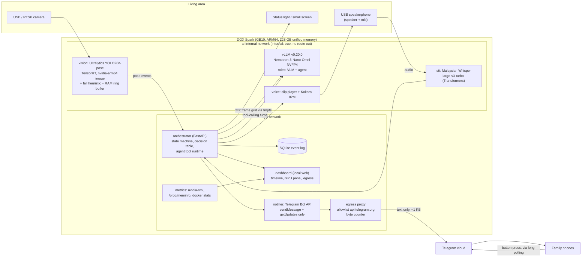
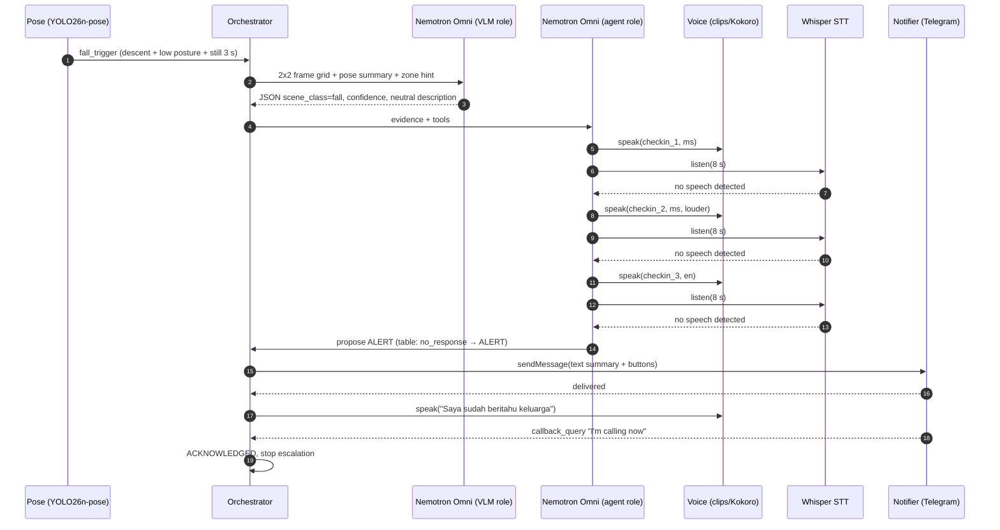
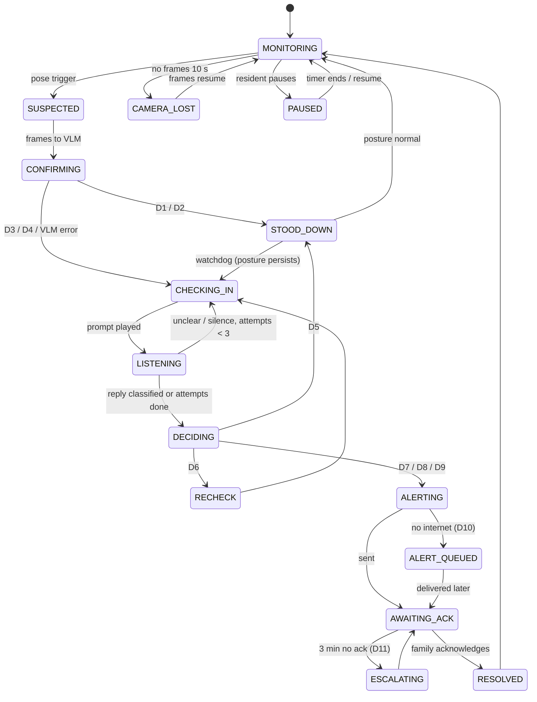
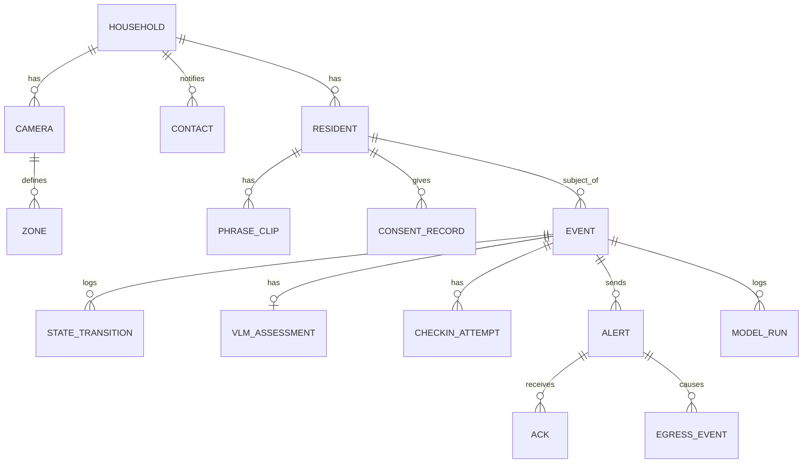

# PRD — GuardianBox: fall detection and voice check-in that keeps the video inside the house

| Field | Value |
|---|---|
| Product name | **GuardianBox** (original working title: "Home Guardian") |
| Owner | Max Saad + team |
| Status | Draft v1.0 — 17 Oct 2026 (Asia/Kuala_Lumpur) |
| Event | ACE 2026 Mini Hackathon (Malaysia) — "LOCAL AI, REAL PROBLEMS" |
| Build window | **3 hours** (falls + voice check-in only) |
| Target hardware | 1× NVIDIA DGX Spark ("the ATOM"): GB10, ARM64, 128 GB unified memory |
| Hard constraints | All inference local. Nemotron is the core LLM/agent. Only a **text** alert leaves the box. No video, frames or audio ever leave the box. |
| Companion | `GuardianBox-UX-spec.md` |
| Research snapshot | dgx-spark-playbooks @ `c035e0a` (15 Oct 2026); NVIDIA Speech NIM support matrices "Last updated Oct 07, 2026" |

Citation tags such as **[PB-NEMOTRON]** resolve in §27 References. A number with no tag is either a design choice (labelled *design*) or **TBM** (to be measured; listed in §25). We do not claim any benchmark, latency or memory figure that is not in a cited source.

---

## 0. TL;DR

A camera in the living area runs a light **pose model** all the time. When the pose looks like a fall, the system wakes **Nemotron 3 Nano Omni**. In its vision role it looks at a few seconds of frames and tells a real fall apart from **sujud (prostration in prayer)**, sitting on the floor, gardening or lying on the sofa. If the fall looks real, the box **speaks** a check-in in the person's language with a familiar honorific ("Pakcik, Pakcik okey tak?"). It **listens** for a reply in Malay, English or Chinese. Nemotron, now in its agent role, then applies an explicit decision table: a clear "I'm fine" stands down; "help", pain, "can't get up" or silence sends a **text-only Telegram alert** to family, with buttons. Video stays in RAM and is never stored or sent.

Model choices (detail in §10):

| Role | v1 pick | Why (source) |
|---|---|---|
| Pose (always on) | **Ultralytics YOLO26n-pose**, TensorRT, in `ultralytics/ultralytics:latest-nvidia-arm64` | Vendor guide for DGX Spark with a ready ARM64 image **[ULTRA-SPARK]**. Pose models use the `-pose` suffix with COCO keypoints **[ULTRA-POSE]**. AGPL-3.0 **[ULTRA-LICENSE]** |
| LLM agent + VLM | **Nemotron-3-Nano-Omni-30B-A3B-Reasoning-NVFP4** on vLLM v0.20.0 (one model, two roles) | Spark recipe **[PB-NEMOTRON]**. Image/video input, JSON output, tool calling **[HF-OMNI]** |
| STT (ms/en/zh) | **mesolitica/Malaysian-whisper-large-v3-turbo-v3** (fallback `openai/whisper-large-v3-turbo`) | Whisper's tokenizer includes `ms`, `zh`, `yue` **[WHISPER-TOK]**. The fine-tune targets "Malay, Manglish, Mandarin, Tamil" **[HF-MESO-WHISPER]**. **No NVIDIA ASR model supported on Spark covers Malay** (§10.3) |
| TTS | **Pre-rendered check-in phrases** (family-recorded voice preferred; otherwise generated once at setup). **Kokoro-82M** for live English/Mandarin lines | Kokoro has no Malay **[KOKORO-VOICES]**. Malay-capable TTS options are heavy or non-commercial (§10.4) |

Memory conclusion (§13): all five **roles** fit in memory together with headroom (planned ≈ 75–90 GB of 128 GB), but only with the lighter speech choices and a reduced vLLM memory fraction. "Instant response" is overclaiming. The models are **warm**, so there is no load delay, but VLM and speech steps each take seconds (TBM). We say "warm, local, seconds not minutes".

---

## 1. Judging criteria scorecard (ACE 2026, out of 100)

We quote only the criteria as given. Each row lists what we build, where it appears in the 5-minute demo (§24), and the evidence a judge can check.

| Criterion (weight) | Concrete features | Demo moment | Evidence for judges |
|---|---|---|---|
| **AI capability (25%)** | Multi-model, multimodal, agentic: (1) pose model always on; (2) **Nemotron Omni as VLM** reading frames to a strict-JSON classification incl. `prayer_sujud`; (3) **Nemotron Omni as agent** calling tools (`speak`, `listen`, `classify_reply`, `send_alert`, `log_event`) under an explicit policy; (4) Malaysian Whisper STT for ms/en/zh incl. code-switching; (5) TTS check-in. Honest count: **5 roles, 4 distinct models** (Omni covers 2 roles); optional 5th model in §10. | Beat 2 (sujud → "prayer recognised, no alert"), Beat 3 (collapse → check-in → silence → alert) | Live **pipeline timeline** on the dashboard: each step with model name, input type, JSON output and latency. `event.json` export |
| **Local AI on the ATOM (25%)** | Video, frames and audio stay in RAM on the Spark. Only ~1 KB of text goes to Telegram. Network egress counter. "Internet down" mode that still detects, checks in, sounds a local alarm and queues the alert. Live GPU/memory panel showing all models resident. | Opening: point at the "No video leaves this box" banner + egress counter. Beat 3: alert payload shown on screen. Optional: pull the uplink and show the local alarm + queued alert | Egress log: only `api.telegram.org`, bytes per alert. Live `nvidia-smi` + `/proc/meminfo` panel. `docker ps` showing every model on the Spark |
| **Impact & feasibility (20%)** | A real fear for Malaysian families with parents living alone. Nothing to wear or charge. Culturally aware (prayer). Honest limits: no bathroom camera in v1; the Spark is demo hardware, not the final home device (§22). | Problem opening + closing | §4 problem, §22 feasibility and cost honesty, §23 metrics (small-sample, not clinical) |
| **Technical implementation (15%)** | Working end-to-end: camera → pose → state machine → VLM JSON → TTS → STT → agent decision → Telegram buttons → acknowledgement back to the dashboard. | Whole demo is live | GitHub repo, `docker compose up`, scripted test suite results table (§21) |
| **Pitch & demo (15%) — 5-min pitch, teamwork, GitHub docs** | 3-beat physical demo, backup clip, role split, README (§26) | Entire pitch | README, repo structure, test results, architecture diagram |

---

## 2. Hackathon fit

- **Brief:** "LOCAL AI, REAL PROBLEMS … Go beyond simple LLM demos to agents, multimodal AI and real-world workflows." GuardianBox is a real-world workflow (detect → confirm → ask → decide → notify). It is multimodal (video, audio, text) and agentic (Nemotron chooses and calls tools under a policy).
- **Why local is the product, not decoration:** the main reason elderly parents refuse cloud CCTV is that someone could watch them 24/7. Here no one can watch: there is no stream and no stored video, and the only thing that leaves is a sentence of text. If the internet drops, detection and the voice check-in still work.
- **Malaysian insight:** a naive fall detector flags sujud. The VLM + agent step tells prayer apart from a fall, and the demo shows it. It also handles Malay, English and Chinese replies and local honorifics.
- **Honest limits stated up front:** bathrooms (a common fall location) are out of scope for v1 because cameras there are a privacy problem; audio-only bathroom mode is future work. Inactivity and 3 am wandering are on the future-work slide. Expect a few seconds of VLM latency (TBM).

### 2.1 Slide-ready one-paragraph pitch

> **GuardianBox watches over parents who live alone, without the video ever leaving the house.** A small pose model on an NVIDIA DGX Spark notices when someone may have fallen. NVIDIA Nemotron then looks at the moment and tells a real fall from a parent kneeling in sujud, resting on the floor or lying on the sofa. It asks, in their own language, "Pakcik, are you okay?", listens for an answer in Malay, English or Chinese, and decides. "I'm fine" means no fuss. "Tolong", pain or silence sends the family a short text alert on Telegram. No pendant to press, no watch to charge, no stranger watching a camera feed: every AI model runs in the home, and only a sentence of text ever goes out.

---

## 3. Problem

Many elderly parents in Malaysia live alone while their children work in another city. The biggest fear is a fall that nobody notices for hours. Current options and their weak points (from the team brief):

| Option | Failure mode |
|---|---|
| Panic-button pendant | Only works if worn and pressed; a person who has fallen may be confused or unconscious |
| Smartwatch fall detection | Needs charging and remembering to wear |
| Cloud CCTV | Family or a company's servers can watch 24/7; many elderly people hate and refuse it |

**Goal (v1/hackathon):** detect a fall in a living area and confirm it locally with a VLM, rejecting the culturally common false alarms. Then check in by voice in ms/en/zh and send family a text-only alert within a short, measured time (TBM), with no video leaving the box.

**Non-goals (v1):** bathroom coverage; inactivity and night-wandering detection; medical diagnosis; replacing emergency services; multi-person households (v1 assumes one resident; visitors are a known false-trigger source, §19).

---

## 4. Users and jobs to be done

| User | Context | JTBD |
|---|---|---|
| **Elderly parent** (primary subject) — e.g. "Pakcik Ahmad", 78, lives alone in Ipoh; or "Auntie Lim", 81, Mandarin/Hokkien speaker | Values independence and privacy; may have hearing or vision decline; may not use smartphones | "If I fall, I want help to come without me having to press anything, and without anyone watching me all day." "If I'm just praying or resting, leave me in peace." |
| **Adult child caregiver** (alert recipient) — works in KL or Singapore | Busy, anxious, on Telegram all day | "Tell me quickly and clearly if Dad may have fallen, what happened and what you've already tried, so I can call him or a neighbour. Don't spam me with false alarms." |
| **Carer / neighbour / sibling** (secondary contact) | Lives nearby, may be the fastest responder | "If the family doesn't answer, tell me so I can check on Auntie." |
| **Installer / family tech person** (often the same adult child) | Sets up camera, zones, contacts, voice recordings | "Set it up in under 30 minutes and know it's working." |
| **Hackathon judge** (demo audience) | 5 minutes | "Show me it's real, local and smarter than a simple detector." |

---

## 5. Scope

### 5.1 Hackathon (3 hours) vs roadmap

| Capability | Hackathon v1 (3 h) | v1.1 (post-event, ~4–6 weeks) | Later |
|---|---|---|---|
| Camera | 1 USB webcam (or 1 RTSP IP camera) | Up to 3 cameras, multi-room | Thermal / depth sensors for low-light privacy |
| Detection | Fall (pose heuristic) | Inactivity ("no movement for long"), 3 am wandering | Gait change trends (with consent) |
| Confirmation | Nemotron Omni VLM on a 2×2 frame grid | Short clip input (video mode), per-home calibration | Fine-tuned VLM on consented local data |
| Voice check-in | Pre-rendered phrases in ms/en/zh, 3 attempts | Dialect phrase packs (Hokkien/Cantonese/Tamil via family recordings) | Natural follow-up conversation |
| STT | Malaysian Whisper, 1 listen window per attempt | Streaming STT, wake phrase "Guardian, tolong" | Speaker verification (resident vs visitor) |
| Decision | Rules + Nemotron agent with tool calls | Per-family escalation policies | Learning from acknowledged outcomes |
| Alert | Telegram text + inline buttons, 2 contacts | Escalation ladder, quiet-hours rules | SMS via local LTE modem (offline), voice call bridge |
| Offline | Local siren + spoken "calling for help" + queued alert | Battery/UPS guidance | Cellular fallback modem |
| Bathroom | **Out of scope** (privacy) | — | Audio-only bathroom mode (thud + call-for-help detection) |
| Dashboard | Setup (camera, zones, contacts), live pipeline timeline, GPU panel, egress counter, event log | Family mobile view over Tailscale | Care-facility multi-home console (privacy review required) |

### 5.2 Hour-by-hour build plan (team of 4, 3 hours)

Precondition: container images and model weights are downloaded **before** the 3-hour window, if the rules allow (open question Q1). vLLM model load alone "can take 10+ minutes" per the vLLM playbook **[PB-vLLM]**.

| Time | A — Vision (pose + heuristic) | B — Nemotron (VLM + agent) | C — Voice (TTS + STT) | D — Dashboard + alerts + demo |
|---|---|---|---|---|
| 0:00–0:20 | Ultralytics container up, webcam frames in, YOLO26n-pose running (export to TensorRT if time allows) | vLLM Omni up (pre-pulled), smoke test image + JSON | Mic/speaker working via USB speakerphone; play a WAV; record 3 s | Telegram bot created via BotFather, test `sendMessage` with inline keyboard **[TG-API]** |
| 0:20–1:10 | Fall heuristic (torso angle, descent speed, floor proximity, stillness) + RAM ring buffer + event emitter | VLM prompt + JSON schema; test on 10 still photos (fall, sujud, sitting, sofa) | Pre-render phrase clips (ms/en/zh) or record them; Whisper listen window with VAD; keyword fallback lists | FastAPI + SSE timeline page; GPU/memory panel; egress counter |
| 1:10–1:50 | Zone calibration (floor, sofa, prayer mat) | Agent loop with tools + decision table guard | Intent classification (Nemotron JSON + keywords) | Alert templates, callback buttons, ack back to the dashboard |
| 1:50–2:25 | **Integration**: end-to-end on a crash mat; tune thresholds | ← | ← | ← |
| 2:25–2:45 | Scripted false-alarm suite (§21.2), record results | Fix prompt misclassifications | Tune listen window and volume | Record the **backup demo clip** |
| 2:45–3:00 | Rehearse the 5-minute pitch twice; freeze code; push README | | | |

Role split: A = vision engineer, B = Max (Nemotron/vLLM/agent, also tech lead), C = speech engineer (ideally a Malay and Mandarin speaker), D = front-end + pitch owner. Each lane works against mocked interfaces (JSON events on a local bus) so the lanes can be integrated at 1:50.

---

## 6. Functional requirements

Priority: **P0** = hackathon v1, **P1** = v1.1, **P2** = later.

### 6.1 Camera ingest (CAM)

| ID | P | Requirement | Acceptance criteria |
|---|---|---|---|
| FR-CAM-1 | P0 | Ingest a USB UVC webcam (`/dev/video*` passed into the vision container) or one RTSP stream (`rtsp://…` via FFmpeg/GStreamer in OpenCV). Default 1280×720 at 10–15 fps for pose (*design*; the real sustainable rate is TBM M3). | Frames arrive with timestamps; fps shown on the dashboard |
| FR-CAM-2 | P0 | Frames live only in a **RAM ring buffer** (default 20 s, *design*). Nothing is written to disk by default. Frames for a VLM call are written to a `tmpfs` path that the vLLM container reads (`--allowed-local-media-path` scoped to that tmpfs) and deleted once the event resolves. | `find` on persistent volumes shows no image or video files after a test run |
| FR-CAM-3 | P0 | Camera-lost detection: no frame for 10 s → `CAMERA_LOST` state; dashboard banner; after 5 min a Telegram "camera offline" notice (text). | Unplugging the USB camera triggers the banner, and the notice after the timeout |
| FR-CAM-4 | P1 | Multiple cameras; per-camera zones. | — |

### 6.2 Pose detection and fall heuristic (POSE)

| ID | P | Requirement | Acceptance criteria |
|---|---|---|---|
| FR-POSE-1 | P0 | Run **YOLO26n-pose** (17 COCO keypoints **[ULTRA-POSE]**) continuously. Use TensorRT export (`format=engine`), which the Spark guide recommends as the highest-performance format **[ULTRA-SPARK]**. Fall back to PyTorch if the export is not ready in time. | Keypoints + confidence per frame; inference ms/frame logged (TBM M2) |
| FR-POSE-2 | P0 | Per-frame features: torso angle from vertical (shoulder midpoint → hip midpoint); bbox aspect ratio; head (nose/eyes) height relative to the calibrated floor line; hip-centre vertical velocity; keypoint motion energy over 2 s windows. | Features visible in the debug overlay |
| FR-POSE-3 | P0 | **Fall trigger** (*design*; thresholds tuned on the mat, final values recorded in README): (a) rapid descent: hip centre drops > 40% of standing body height in < 1.0 s, **then** (b) low posture: torso angle > 60° or head below the knee line near the floor, **then** (c) low motion energy for ≥ 3 s (demo) / ≥ 10 s (home default). Any of (a)+(b) without (c) is logged as `low_posture_brief`. | Mat falls trigger; walking, sitting on a chair and bending do not trigger (§21) |
| FR-POSE-4 | P0 | **Slow-onset trigger** (catches slumps and controlled descents that (a) misses): low posture outside the sofa/bed zones for ≥ 20 s with low motion. | Lying on the floor slowly triggers after 20 s |
| FR-POSE-5 | P0 | Zone hints from setup: `floor`, `sofa/bed`, `prayer_area`, `chair`. Low posture inside `sofa/bed` does not trigger unless (a) rapid descent occurred. Inside `prayer_area` the event still goes to the VLM (never suppressed by zone alone) with a prayer-context hint. | Lying on the sofa zone: no trigger. Sujud on the prayer mat: VLM called, classified, no alert |
| FR-POSE-6 | P0 | **Prayer rhythm feature**: count low-posture ↔ upright transitions in the last 60 s. Repeated cycles (sujud is performed in repeated cycles within a prayer) are passed to the VLM/agent as context, not used as an automatic suppression. | Feature value appears in the VLM prompt context |
| FR-POSE-7 | P0 | No person detected for > N minutes while the system is armed → log only (v1). Inactivity alerts are v1.1. | — |

### 6.3 Event state machine (EVT)

| ID | P | Requirement | Acceptance criteria |
|---|---|---|---|
| FR-EVT-1 | P0 | Implement the state machine in §12 deterministically in the orchestrator. Models never change state directly; they return data that the orchestrator evaluates. | Unit tests cover every transition |
| FR-EVT-2 | P0 | One active event at a time per resident. New pose triggers during an active event are attached as evidence. | — |
| FR-EVT-3 | P0 | **Watchdog**: after any stand-down (prayer recognised, "I'm fine"), if low posture persists beyond `T_persist` (*design*: 3 min for prayer, 2 min after "I'm fine"), re-enter `CHECKING_IN`. This covers a collapse during prayer, or someone who says they're fine but cannot get up. | Test: hold the sujud posture past T_persist → check-in occurs |
| FR-EVT-4 | P0 | Every transition is timestamped (stored UTC, displayed MYT) and streamed to the dashboard over SSE. | Timeline shows each step |

### 6.4 VLM confirmation (VLM)

| ID | P | Requirement | Acceptance criteria |
|---|---|---|---|
| FR-VLM-1 | P0 | On `SUSPECTED`, build a **2×2 grid image** of 4 frames spanning the last ~6 s, with a timestamp burned into each tile, plus the pose feature summary as text. Send it to Nemotron Omni as one image. The Spark recipe limits multimodal input to 1 image, 1 video and 1 audio per prompt (`--limit-mm-per-prompt '{"video":1,"image":1,"audio":1}'`) **[PB-NEMOTRON]**, so the grid is one image. v1.1 option: send a short mp4 clip (the model accepts video input **[HF-OMNI]**). | One request per event; the request contains no identity data |
| FR-VLM-2 | P0 | Instruct (non-thinking) mode for low latency and clean JSON: `chat_template_kwargs: {enable_thinking: false}`, sampling per the model card's instruct guidance (temperature 0.2, top_k 1) **[HF-OMNI]**. Use `response_format: json_schema` if it works with the reasoning parser on v0.20.0 (Q3); always validate server-side and retry once on invalid output. | ≥ 95% schema-valid responses on the test set (target; TBM M11) |
| FR-VLM-3 | P0 | Output schema `vlm-assessment.v1` (below). It includes explicit non-fall classes for **prayer (sujud and other positions), kneeling to pick something up, sitting on the floor, gardening/floor work, lying on the sofa or bed, exercising**. | Schema-valid JSON |
| FR-VLM-4 | P0 | Prompt includes cultural context ("The resident may perform Muslim prayer (solat), which includes kneeling, prostration with forehead on the floor (sujud) and sitting positions, usually on a prayer mat, in repeated cycles. This is normal, not a fall."), the zone hint, and the prayer-rhythm feature. The prompt forbids identifying people or describing appearance beyond what safety needs. | Prompt in `prompts/vlm_confirm.md`, versioned |
| FR-VLM-5 | P0 | **Fail-safe**: VLM timeout (default 15 s, *design*), invalid JSON after retry, or `confidence < 0.6` → treat as `uncertain` → proceed to check-in. Never stand down because the VLM failed. | Kill vLLM mid-test → check-in still happens |
| FR-VLM-6 | P0 | The VLM's `description` (≤ 160 chars, neutral wording) is the only VLM content that may go into a family alert. It is filtered for identity or appearance terms before use. | Alert text contains no clothing, face or body descriptions beyond posture and location |

`vlm-assessment.v1` schema:

```json
{
  "$schema": "https://json-schema.org/draft/2020-12/schema",
  "$id": "https://guardianbox.local/schemas/vlm-assessment.v1.json",
  "type": "object",
  "additionalProperties": false,
  "required": ["person_visible", "scene_class", "posture", "movement", "fall_likelihood", "confidence", "description"],
  "properties": {
    "person_visible": { "type": "boolean" },
    "scene_class": {
      "enum": [
        "fall",
        "lying_on_floor_unclear_cause",
        "prayer_sujud",
        "prayer_other_position",
        "kneeling_to_pick_up_or_reach",
        "sitting_on_floor_resting",
        "gardening_or_floor_work",
        "lying_on_sofa_or_bed",
        "exercising_or_stretching",
        "no_person_or_unclear"
      ]
    },
    "posture": { "enum": ["standing", "sitting_chair", "sitting_floor", "kneeling", "prostrate_forehead_down", "lying_floor", "lying_furniture", "crouching", "unknown"] },
    "on_prayer_mat_or_area": { "type": "boolean" },
    "movement": { "enum": ["none_visible", "small", "purposeful"] },
    "distress_signs": {
      "type": "array", "maxItems": 5,
      "items": { "enum": ["not_moving", "awkward_limb_position", "face_down_not_prayer", "object_knocked_over", "near_furniture_edge", "holding_body_part"] }
    },
    "fall_likelihood": { "type": "number", "minimum": 0, "maximum": 1 },
    "confidence": { "type": "number", "minimum": 0, "maximum": 1 },
    "description": { "type": "string", "maxLength": 160 },
    "reasons": { "type": "array", "maxItems": 4, "items": { "type": "string", "maxLength": 80 } }
  }
}
```

### 6.5 Voice check-in — TTS (TTS)

| ID | P | Requirement | Acceptance criteria |
|---|---|---|---|
| FR-TTS-1 | P0 | Check-in phrases are **pre-rendered WAV clips** per resident: honorific + name + phrase, in the resident's languages (exact scripts in UX-spec §3). Source priority: (1) **recorded by a family member** in setup; (2) generated once at setup with a local TTS (§10.4). Playback needs no model at event time. | Clip plays within 300 ms of `CHECKING_IN` (target; TBM M7) |
| FR-TTS-2 | P0 | Live TTS for dynamic lines (e.g. "Saya sudah beritahu Mei. Bantuan sedang datang." / "I've told Mei, help is coming") uses pre-rendered variants per contact name. Kokoro-82M is used only for English/Mandarin lines that were not pre-rendered **[KOKORO-VOICES]**. | No missing-clip errors in the test suite |
| FR-TTS-3 | P0 | Playback volume set at setup with a test tone and a spoken sample. Default volume high (*design*). Speech rate slightly slow (Kokoro `speed` ≈ 0.9, *design*). A chime plays before each prompt to get attention. | Installer confirms audibility from the far side of the room |
| FR-TTS-4 | P0 | The microphone is muted (or its input ignored) during playback, to avoid transcribing our own prompt. | No self-transcription in the logs |

### 6.6 Listening — STT (STT)

| ID | P | Requirement | Acceptance criteria |
|---|---|---|---|
| FR-STT-1 | P0 | After each prompt: short beep, then a **listen window** of 8 s (*design*), extended while voice activity continues, up to 15 s. Voice activity detection with Silero VAD (the same VAD NVIDIA's ASR NIM profiles use **[NIM-ASR]**; package licence to confirm). | Listen window and VAD state visible on the timeline |
| FR-STT-2 | P0 | Transcribe with **Malaysian Whisper large-v3-turbo-v3** (Transformers, BF16, on GPU) **[HF-MESO-WHISPER]**. Language auto-detected, restricted to {ms, en, zh}. Code-switching (Manglish, Malay–English mixing) is expected. | Transcript + detected language + avg log-prob stored on the event |
| FR-STT-3 | P0 | **Up to 3 attempts** (*design*). Attempt 2 is louder and simpler. Attempt 3 is in the resident's second language if configured. Total check-in budget ≈ 45 s (*design*; demo profile 20 s). | Silence × 3 → `no_response` |
| FR-STT-4 | P0 | Treat low-confidence transcripts (e.g. no-speech probability high, or VAD speech < 0.3 s) as `unclear`, not `ok`. | "Mm" or noise never stands down |
| FR-STT-5 | P1 | Fallbacks: `openai/whisper-large-v3-turbo` (MIT) **[HF-WHISPER-TURBO]**; Nemotron ASR Streaming NIM `type=multi` for en/zh, which is supported on DGX Spark but **does not list Malay** **[NIM-ASR]**. | — |

### 6.7 Agent decision (AGT)

| ID | P | Requirement | Acceptance criteria |
|---|---|---|---|
| FR-AGT-1 | P0 | Nemotron Omni acts as the agent through OpenAI-style tool calling (`--enable-auto-tool-choice --tool-call-parser qwen3_coder` in the Spark recipe **[PB-NEMOTRON]**). Tools: `get_event_evidence()`, `speak(phrase_id, lang)`, `listen(seconds)`, `classify_reply(transcript)`, `send_family_alert(level, summary)`, `sound_local_alarm()`, `log_event(note)`, `schedule_recheck(seconds)`. | Each tool call logged with arguments and result |
| FR-AGT-2 | P0 | **Policy guard**: the deterministic decision table (§11) is authoritative. The agent can *add* actions (e.g. an extra check-in in another language, or a clearer alert summary) but cannot override an `ALERT` outcome into `STAND_DOWN`. If the agent's proposal conflicts with the table, the orchestrator uses the table and logs the conflict. | Unit test: agent proposes stand-down on "silence" → table forces alert |
| FR-AGT-3 | P0 | `classify_reply` returns `{intent, language, confidence, quote}` with intents `ok_no_help`, `needs_help`, `pain_or_injury`, `cannot_get_up`, `call_family`, `unclear`. A **keyword floor** runs first, in three languages (e.g. "tolong", "sakit", "tak boleh bangun", "help", "pain", "can't get up", "救命", "帮忙", "痛", "起不来"). A keyword hit for help, pain or can't-get-up escalates regardless of the LLM output. | Keyword unit tests in ms/en/zh |
| FR-AGT-4 | P0 | Summary generation for the alert: the agent drafts ≤ 300 chars from structured fields only (time, zone, VLM class + description, check-in outcome, quote ≤ 60 chars). The template engine validates it (§FR-ALR-3). On any problem, fall back to the fixed template. | Alerts always send, even if the LLM is down |
| FR-AGT-5 | P0 | **LLM down** → the orchestrator executes the table with fixed templates. The pipeline never blocks on the agent. | Kill vLLM → the alert still goes out |

### 6.8 Alerts — Telegram text only (ALR)

| ID | P | Requirement | Acceptance criteria |
|---|---|---|---|
| FR-ALR-1 | P0 | Send with Telegram Bot API `sendMessage` to each configured `chat_id`, with `reply_markup.inline_keyboard` buttons whose `callback_data` carries `event_id:action`. Button presses arrive as `callback_query` updates and are answered with `answerCallbackQuery` **[TG-API]**. Receive updates by **long polling (`getUpdates`)**, so no inbound port is opened on the home network **[TG-API]**. | Button press updates the dashboard within 5 s of the poll cycle |
| FR-ALR-2 | P0 | Buttons: **📞 I'm calling now**, **🏃 On my way**, **✅ False alarm**, **🆘 Call 999 advice** (shows guidance text; it does not dial). Acknowledgement stops escalation; "False alarm" records a label for later tuning (local only). | — |
| FR-ALR-3 | P0 | **Text only.** The payload never contains images, video, audio, URLs to media or raw keypoints. A payload guard rejects any `sendPhoto`, `sendVideo`, `sendAudio`, `sendVoice` or `sendDocument` call at the code level (an allowlist of `sendMessage`, `answerCallbackQuery`, `getUpdates`, `editMessageText`). Max 1,024 chars (*design*). | Code-level test: attempting `sendPhoto` raises an error. The egress log shows payload sizes |
| FR-ALR-4 | P0 | Escalation: no acknowledgement in 3 min (*design*) → re-send to contact 1 and send to contact 2. No acknowledgement in 10 min → repeat every 5 min, max 6 times, and sound the local alarm periodically. | Timeline shows escalation steps |
| FR-ALR-5 | P0 | **Internet down**: if Telegram is unreachable, (1) queue the alert with exponential backoff, (2) speak "Saya sedang cuba hubungi keluarga…" plus the local alarm (a siren tone through the speaker) so neighbours may hear, (3) show `ALERT QUEUED — NO INTERNET` on the dashboard. Deliver as soon as connectivity returns, with the original event time. We do **not** claim the family is notified while offline. | Pull the uplink → siren plays, alert queued, delivered on reconnect with "delayed" marked |
| FR-ALR-6 | P2 | SMS via a local USB LTE modem as an offline path (future; not built). | — |
| FR-ALR-7 | P0 | System notices (text): camera offline, monitoring paused/resumed (only if the resident consents to pause notifications), model service down for > 5 min. | — |

### 6.9 Event log (LOG)

| ID | P | Requirement | Acceptance criteria |
|---|---|---|---|
| FR-LOG-1 | P0 | SQLite event log: event type, state transitions, pose feature summary (numbers only), VLM JSON, check-in attempts (phrase IDs, transcripts, intents), decision, alerts, acknowledgements, model runs (role, model, latency). **No frames.** | `event.json` export per event |
| FR-LOG-2 | P0 | Retention: 90 days default (*design*); delete-all button; transcripts can be disabled (store intent only). | — |
| FR-LOG-3 | P1 | Weekly text summary to family (opt-in by resident). | — |

### 6.10 Privacy guarantees (PRIV)

| ID | P | Requirement | Acceptance criteria |
|---|---|---|---|
| FR-PRIV-1 | P0 | **No video leaves the box.** Model containers sit on an internal Docker network with no route out. Only the notifier container can reach the internet, through an egress proxy that allowlists `api.telegram.org`. | Egress counter: 0 bytes to any host except Telegram; per-alert payload ≤ 2 KB |
| FR-PRIV-2 | P0 | **No video stored by default.** RAM ring buffer only; tmpfs for VLM frames; deleted after resolution. Optional "keep a still for 24 h for my own review" is off by default and local only. | Disk scan in the test plan |
| FR-PRIV-3 | P0 | **Dignified live view**: the dashboard shows a **skeleton-only view** by default. Live video is shown only during camera setup, with a visible red "LIVE VIDEO" badge, and it auto-reverts after 5 min. | — |
| FR-PRIV-4 | P0 | **Resident control**: a "Pause monitoring" control (dashboard + optional physical USB button) with auto-resume after a chosen time (30/60/120 min). Pausing is logged. Whether family are told is the resident's choice at consent time. | — |
| FR-PRIV-5 | P0 | A visible indicator in the room (a small screen or LED) when the system is active. | UX-spec §5 |
| FR-PRIV-6 | P0 | Telemetry off for all components; no cloud keys in the environment; Hugging Face offline mode on model servers (`HF_HUB_OFFLINE=1`, as the vLLM playbook's launch script sets **[PB-vLLM-128]**). | Config check in CI |

---

## 7. Non-functional requirements

| ID | Area | Requirement |
|---|---|---|
| NFR-1 | Privacy | As §6.10. Only text to Telegram. Network isolation is enforced by Docker networks plus the egress proxy, not by trust. |
| NFR-2 | Storage | No video or frames on persistent storage by default. RAM ring buffer ≤ 20 s. tmpfs for VLM inputs. |
| NFR-3 | Latency (**all TBM**) | Targets (*design*): pose trigger ≤ 1 s after the stillness condition; VLM verdict ≤ 5 s (the brief expects "a few seconds"); first check-in prompt ≤ 1 s after the verdict; STT ≤ 2 s per reply; alert sent ≤ 2 s after decision. End-to-end from fall to Telegram, silent case: ≈ stillness window + VLM + 3 × (prompt + listen) ≈ 60 s home profile / ≈ 30 s demo profile. Measured values replace these in the README (M4–M10). |
| NFR-4 | Memory | All roles resident simultaneously within ≤ 95 GB planned (§13), leaving ≥ 30 GB headroom. Verified with the GPU panel (M1, M12). |
| NFR-5 | Reliability | Every model service has a health check. The orchestrator works without the LLM (fixed rules) and without the VLM (fail-safe to check-in). Watchdog restarts crashed containers (`restart: unless-stopped`). Camera-lost notices. |
| NFR-6 | False positives | Target: 0 false family alerts on the scripted non-fall suite (§21.2). Non-fall detections are allowed to trigger the VLM (that is the design), but must not alert. |
| NFR-7 | False negatives | Bias toward safety. Uncertain → ask. Silence → alert. VLM failure → ask. A prayer or "I'm fine" stand-down has a watchdog. Target: ≥ 9/10 mat falls produce a check-in, and all silent ones produce an alert. |
| NFR-8 | ARM64 | Every container has a linux/arm64 build. Known-good: `vllm/vllm-openai:v0.20.0` multi-arch **[PB-NEMOTRON]**; `ultralytics/ultralytics:latest-nvidia-arm64` **[ULTRA-SPARK] [ULTRA-DOCKER]**; NGC PyTorch base for Whisper. ARM64 risks: CTranslate2/faster-whisper GPU wheels on aarch64 (unverified, so we use Transformers); `onnxruntime-gpu` aarch64 (the Ultralytics guide gives conflicting notes; use its Docker image) **[ULTRA-SPARK]**; audio devices in containers. |
| NFR-9 | Accessibility | Voice prompts audible at distance, slow and simple; supports hearing-impaired settings (louder, repeat, flashing light, P1). Dashboard WCAG 2.2 AA (UX-spec §8). |
| NFR-10 | Safety disclaimer | Not a medical device and not a replacement for emergency services. Stated in setup and in the README. |
| NFR-11 | Power and boot | Autostart on boot; status Telegram message "GuardianBox is running" after boot (*design*). A UPS is recommended (P1). |

---

## 8. System architecture

### 8.1 Component diagram



### 8.2 Sequence: collapse → silence → alert



### 8.3 Components mapped to playbooks and sources

| Component | Technology | Grounding |
|---|---|---|
| LLM agent + VLM server | vLLM `v0.20.0`, Nemotron 3 Nano Omni NVFP4, OpenAI API on `127.0.0.1:8000` | Spark `docker run` recipe in the Nemotron playbook **[PB-NEMOTRON]**; model card **[HF-OMNI]**; vLLM ops notes (UMA memory reporting, cache flush, unauthenticated API) **[PB-vLLM]** |
| Pose | Ultralytics YOLO26n-pose, TensorRT engine, image `ultralytics/ultralytics:latest-nvidia-arm64` run with `--device nvidia.com/gpu=all` | Ultralytics DGX Spark guide **[ULTRA-SPARK]**; pose task docs **[ULTRA-POSE]** |
| STT | `mesolitica/Malaysian-whisper-large-v3-turbo-v3` in an NGC PyTorch container (arm64) | Model card **[HF-MESO-WHISPER]**; Whisper language list **[WHISPER-TOK]** |
| TTS | Pre-rendered clips + Kokoro-82M | Kokoro used on Spark in NVIDIA's photo-booth playbook (`hexgrad/Kokoro-82M`) **[PB-REACHY]**; voice/language list **[KOKORO-VOICES]** |
| Pattern reference: local VLM alert verification | NVIDIA VSS Blueprint "Alert Verification" with a local Cosmos-Reason2-8B VLM on DGX Spark | **[PB-VSS]**. Note: that playbook uses a **remote** LLM ("Standard VSS hybrid deployment … uses remote model endpoints for the LLM"), so we borrow the pattern, not the deployment |
| Pattern reference: webcam → VLM | Live VLM WebUI (webcam → OpenAI-compatible VLM; HTTPS needed for browser camera access) | **[PB-LIVEVLM]** |
| Remote admin | NVIDIA Sync / Tailscale | **[PB-SYNC] [PB-TAILSCALE]** |
| Ops dashboard backup | DGX Dashboard `localhost:11000` | **[PB-DASH]** |

---

## 9. Why a VLM step at all (and why the agent)

A pose heuristic sees geometry: low torso, head near the floor, stillness. Sujud matches all three: the forehead, nose, palms, knees and toes touch the floor, held still for a few seconds. So does sitting on the floor to rest, kneeling to weed a pot, or lying on a low sofa. The VLM adds **context**: a prayer mat, the orderly posture with hands placed beside the head, the person sitting back up in the next tile, a sofa underneath, a trowel in hand. The agent adds **conversation and judgement**: it asks, understands a reply in three languages, and follows an explicit escalation policy. This is the "more than a simple detector" story, and it is demonstrable.

---

## 10. Model selection

### 10.1 Can Nemotron-3-Nano-Omni cover the VLM and STT roles?

| Role | Verdict | Evidence |
|---|---|---|
| **LLM agent** (core, required) | **Yes** | Tool calling and JSON output listed on the model card; the Spark recipe enables `--enable-auto-tool-choice --tool-call-parser qwen3_coder --reasoning-parser nemotron_v3` **[HF-OMNI] [PB-NEMOTRON]** |
| **VLM** (fall confirmation) | **Yes** | Image and video input (mp4 up to 2 min) listed on the model card **[HF-OMNI]**; the Spark recipe sets `--limit-mm-per-prompt` to one image/video/audio **[PB-NEMOTRON]**. Fall-vs-sujud accuracy is **not** published anywhere, so it is TBM (M11) |
| **STT** | **English only, so not enough here** | The model takes audio input with word-level timestamps, but the card states English-only language support **[HF-OMNI]**. Malay and Chinese replies need a separate STT model |
| TTS | **No** | Output is text only **[HF-OMNI]** |

So Omni covers **2 of the 5 roles** (agent + VLM). STT and TTS need separate models.

### 10.2 Final selection with alternatives

| Role | v1 choice | Serving on Spark | Size / memory (sourced) | Alternatives (and why not first) |
|---|---|---|---|---|
| Pose | **YOLO26n-pose** (Ultralytics) | `ultralytics/ultralytics:latest-nvidia-arm64` (NVIDIA PyTorch 26.08, CUDA 13.4, TensorRT 11.2 per the guide) **[ULTRA-SPARK]** | Pose-model memory on Spark not published (TBM M2). For scale: the guide's **YOLO11n detection** TensorRT FP16 benchmark on Spark is 7.0 MB on disk and 1.01 ms/image at 640 **[ULTRA-SPARK]** (detection, not pose) | **MediaPipe Pose Landmarker**: Apache-2.0, aarch64 wheel on PyPI (`mediapipe-1.1.1-…manylinux_2_28_aarch64`) **[MEDIAPIPE-PYPI]**, CPU-friendly, licence-friendly for commercial use; GPU path on Linux unverified. **RTMPose/RTMO via rtmlib** (Apache-2.0, no mmcv) **[RTMLIB-PYPI]**; ARM64 GPU path unverified. **Licence note:** Ultralytics is **AGPL-3.0** **[ULTRA-LICENSE]**. Fine for an open-source hackathon repo; a closed commercial product needs an Ultralytics enterprise licence or a switch to MediaPipe/RTMPose |
| Agent (LLM) | **Nemotron-3-Nano-Omni-30B-A3B-Reasoning-NVFP4** | vLLM `v0.20.0` **[PB-NEMOTRON]** | 20.9 GB NVFP4 checkpoint; 31B total / ~3B active **[HF-OMNI]** | Nemotron 3.5 Lightning 30B-A3B NIM (~30 GB NVFP4 before KV **[PB-NIM]**): text-only, so it needs a separate VLM. Nemotron Nano 9B v2: the VSS playbook recommends it for alert workflows as a **remote** model **[PB-VSS]**; local Spark serving unverified |
| VLM | **Same Omni instance** | same | shared | **Cosmos-Reason2-8B**: physical-AI reasoning VLM; run locally on DGX Spark in the VSS playbook **[PB-VSS]**; the card says "minimum of 32 GB of GPU memory" and is tested on BF16 **[HF-COSMOS-R2]**. A strong v1.1 candidate for a dedicated VLM (5 distinct models) if Omni misreads sujud. Cosmos-Reason2-2B is smaller (memory TBM). Gemma 3 4B via Ollama (live-vlm-webui default **[PB-LIVEVLM]**) |
| STT | **mesolitica/Malaysian-whisper-large-v3-turbo-v3** | Transformers BF16 in an NGC PyTorch arm64 container (the model card's own example uses `WhisperForConditionalGeneration` in bfloat16 on CUDA) **[HF-MESO-WHISPER]** | Weights file 1.62 GB (`model.safetensors`, repo listing) **[HF-MESO-WHISPER]**; runtime memory TBM (M5) | `openai/whisper-large-v3-turbo` (MIT, tags include ms/zh) **[HF-WHISPER-TURBO]**, served by vLLM's `/v1/audio/transcriptions` (needs `vllm[audio]`) **[VLLM-STT]**. NVIDIA options on Spark do **not** cover Malay (§10.3) |
| TTS | **Pre-rendered clips** (family voice preferred) + **Kokoro-82M** (en/zh live lines) | Kokoro: CPU/GPU, as in the photo-booth stack **[PB-REACHY]** | Kokoro is 82M params (name); memory TBM (M6) | Malay generation: **Chatterbox Multilingual** (MIT; `ms` tag **[HF-CHATTERBOX]**; NIM on Spark with `ms-MY` voice, but its Spark profile needs **44.61 GiB GPU + 4.86 GiB host** **[NIM-TTS]**, so use it at setup only, not resident). **MMS-TTS Malay** `facebook/mms-tts-zlm`: small, but **CC-BY-NC-4.0** (non-commercial) **[HF-MMS-ZLM]**. **Magpie TTS Multilingual** NIM: Spark-supported, en + zh-CN but **no Malay**; batch_size=8 profile 12.58 GiB GPU + 5.18 GiB host **[NIM-TTS]** |
| Optional 5th distinct model | Nemotron ASR Streaming NIM `type=multi` (en/zh streaming) | NIM on Spark **[NIM-ASR]** | batch_size=32 profile: 4 GB GPU + 9 GB CPU **[NIM-ASR]** | Adds an NVIDIA speech model for English/Mandarin but still needs Whisper for Malay. Add only if time allows |

### 10.3 Malay / English / Chinese language support — honest findings

**STT**

| Model | Malay | English | Chinese | Runs on DGX Spark? | Source |
|---|---|---|---|---|---|
| Nemotron 3 Nano Omni (ASR) | ✗ | ✓ | ✗ | ✓ (vLLM recipe) | English-only per card **[HF-OMNI]** |
| Parakeet TDT 0.6B v3 | ✗ (25 European languages) | ✓ | ✗ | Model card lists Blackwell; NIM: **not** in the Spark-supported list **[HF-PARAKEET-V3] [NIM-ASR]** | |
| Canary 1B v2 | ✗ (25 European languages) | ✓ | ✗ | Not in the Spark-supported NIM list **[HF-CANARY-V2] [NIM-ASR]** | |
| Parakeet 1.1B RNNT Multilingual (NIM) | ✗ (not in its language table) | ✓ | ✗ (not in its table) | ✓ ("supported on Blackwell and DGX Spark") | **[NIM-ASR]** |
| Nemotron ASR Streaming (NIM, `type=multi`, 40 locales) | ✗ (not listed) | ✓ (transcription-ready) | ✓ zh-CN (broad-coverage tier) | ✓ | **[NIM-ASR]** |
| Riva Whisper (multilingual) | ✓ `ms` listed | ✓ | ✓ `zh`, `yue` | Whisper Large v3 NIM exists, but DGX Spark's note lists only Parakeet 1.1B CTC English, Parakeet 1.1B RNNT Multilingual and Nemotron ASR Streaming | **[RIVA-ASR] [NIM-ASR]** |
| OpenAI Whisper large-v3-turbo (open weights) | ✓ `ms` | ✓ | ✓ `zh`, `yue` | Should run (PyTorch on arm64 CUDA, or vLLM transcription API); **not validated on Spark** (M5) | **[WHISPER-TOK] [HF-WHISPER-TURBO] [VLLM-STT]** |
| mesolitica Malaysian-whisper-large-v3-turbo-v3 | ✓ (Malay, Manglish) | ✓ | ✓ Mandarin | Same runtime as Whisper; not validated (M5) | **[HF-MESO-WHISPER]** |

**TTS**

| Model | Malay | English | Mandarin | Spark | Licence | Source |
|---|---|---|---|---|---|---|
| Kokoro-82M | **✗** | ✓ (af_heart grade A) | ✓ but all zh voices grade **D** | ✓ (photo-booth playbook) | Apache-2.0 | **[KOKORO-VOICES] [PB-REACHY]** |
| Magpie TTS Multilingual (NIM) | **✗** | ✓ | ✓ zh-CN | ✓ | NVIDIA NIM terms | **[NIM-TTS]** |
| Chatterbox TTS Multilingual (NIM / open source) | ✓ ms-MY (one male voice in NIM) | ✓ | ✓ zh-CN | ✓ NIM batch_size=8 only; 44.61 GiB GPU | MIT (model); NIM hosting under NVIDIA terms | **[NIM-TTS] [HF-CHATTERBOX]** |
| MMS-TTS Malay (`facebook/mms-tts-zlm`) | ✓ | — | — | Not validated (small VITS model) | **CC-BY-NC-4.0** | **[HF-MMS-ZLM]** |

**Gaps, stated plainly**

1. **No NVIDIA speech model supported on DGX Spark recognises Malay.** Malay STT relies on Whisper-family open models, which are not yet validated on Spark.
2. **Malay TTS options are weak for a resident service**: Chatterbox needs ~45 GiB GPU in its Spark NIM profile, and NVIDIA's own doc warns that "Non-English languages have reported issues with pronunciation, mixed-language output, hallucinated words" **[NIM-TTS]**. MMS is non-commercial. Our answer is that check-in phrases are fixed, so we **pre-render or record them once** (the family's own voice is better anyway), and no Malay TTS has to run at event time.
3. **Chinese dialects** (Hokkien, Cantonese) common among older Malaysian Chinese are not covered by Kokoro or Magpie TTS. Whisper's tokenizer includes Cantonese (`yue`) **[WHISPER-TOK]**, but Hokkien is not in the list. Mitigation: family-recorded clips; listen with Mandarin + keyword fallback; dialect accuracy TBM (M9).
4. **Elderly speech** (weak, slurred, accented, in pain) is not represented in any published benchmark we found. It must be tested with real voices (with consent).

### 10.4 vLLM launch (project configuration)

Based on the Spark recipe **[PB-NEMOTRON]** and model card **[HF-OMNI]**; † marks deviations for co-residency (validate in M1).

```bash
docker run -d --name vllm --gpus all --ipc=host --network ai-internal \
  -p 127.0.0.1:8000:8000 -e HF_HUB_OFFLINE=1 \
  -v $HOME/.cache/huggingface:/root/.cache/huggingface \
  -v /run/gb-frames:/frames:ro \
  vllm/vllm-openai:v0.20.0 \
  nvidia/Nemotron-3-Nano-Omni-30B-A3B-Reasoning-NVFP4 \
  --served-model-name nemotron_3_nano_omni --trust-remote-code \
  --host 0.0.0.0 --port 8000 \
  --max-num-seqs 2 \                    # † recipe: 8
  --max-model-len 16384 \               # † recipe: 131072
  --gpu-memory-utilization 0.35 \       # † recipe: 0.8
  --kv-cache-dtype fp8 \                # per card's general invocation for non-BF16
  --limit-mm-per-prompt '{"video":1,"image":1,"audio":1}' \
  --allowed-local-media-path=/frames \  # † recipe: /
  --enable-prefix-caching \
  --reasoning-parser nemotron_v3 \
  --enable-auto-tool-choice --tool-call-parser qwen3_coder
```

Remove the inline `#` comments before running. The audio extra (`vllm[audio]`) is not needed, because we don't send audio to Omni. The model card documents lowering `--gpu-memory-utilization` and then `--max-model-len` to free memory **[HF-OMNI]**. Whether 0.35 is enough for a 4-tile image plus a 16k context is **M1**.

---

## 11. Agent decision table (authoritative policy)

Inputs: VLM `scene_class` + `confidence`; pose stillness; check-in outcome (`intent` per attempt); elapsed time; connectivity. "Alert" = Telegram text to contact 1 (then the escalation ladder).

| # | VLM result | Check-in outcome | Other conditions | Decision | Spoken response (UX-spec §3) |
|---|---|---|---|---|---|
| D1 | `prayer_sujud` / `prayer_other_position`, conf ≥ 0.7 | not asked | — | **Stand down silently**, log "prayer recognised". Watchdog: re-check if low posture persists > 3 min | none (never interrupt prayer) |
| D2 | `lying_on_sofa_or_bed`, `sitting_on_floor_resting`, `kneeling_to_pick_up_or_reach`, `gardening_or_floor_work`, `exercising_or_stretching`, conf ≥ 0.7 | not asked | No rapid descent preceded | **Stand down**, log. Watchdog 10 min if on the floor | none |
| D3 | Any non-fall class, conf ≥ 0.7 | not asked | Rapid descent **did** precede (FR-POSE-3a) | **Soft check-in** (one gentle prompt); on `ok_no_help` stand down; otherwise go to D5–D9 | "Pakcik okey?" (soft) |
| D4 | `fall`, `lying_on_floor_unclear_cause`, `no_person_or_unclear`, or conf < 0.6, or VLM error/timeout | — | — | **Check-in** (up to 3 attempts) | full check-in |
| D5 | (from D3/D4) | `ok_no_help` clearly ("Saya okey", "I'm fine", "我没事") | Person moves / gets up within 2 min | **Stand down**, log; say thanks | "Baik, Pakcik. Saya ada di sini kalau perlu." |
| D6 | (from D3/D4) | `ok_no_help` | Still on the floor after 2 min | **Re-check**: "Pakcik boleh bangun?" If "cannot" or silence → **Alert (level: needs help)** | re-check prompt |
| D7 | (from D3/D4) | `needs_help`, `pain_or_injury`, `cannot_get_up`, `call_family` (keyword floor or LLM) | — | **Alert immediately** (level: urgent) + reassure | "Saya sedang beritahu keluarga sekarang." |
| D8 | (from D3/D4) | `no_response` after all attempts | — | **Alert** (level: urgent — no response) + periodic local chime | "Saya akan minta bantuan." |
| D9 | (from D3/D4) | `unclear` on all attempts | — | **Alert** (level: needs check — unclear reply) | same as D8 |
| D10 | any alerting row | — | Telegram unreachable | **Queue alert + local siren + spoken notice**, retry with backoff | "Saya cuba hubungi keluarga." |
| D11 | any alerting row | — | No acknowledgement in 3 min | **Escalate** to contact 2; repeat per FR-ALR-4 | — |
| D12 | any | — | Resident set "pause" | No detection; pause logged; resumes automatically | — |

Rules of precedence: D7 > D8/D9 > D6 > D5. A keyword hit for help, pain or can't-get-up always wins. The agent may *add* a language switch or an extra attempt (max 1) but never removes an alert. The confidence thresholds 0.6 and 0.7 are *design* starting values, tuned with the test suite (M11).

---

## 12. Event state machine



---

## 13. Memory budget: can all five roles stay loaded?

DGX Spark has 128 GB of unified memory shared by CPU and GPU, and no MIG (the MIG playbook covers DGX Station, not Spark **[PB-MIG]**). On UMA, NIM "GPU memory" and "host memory" figures both come from the same pool, so we **add them**.

| Consumer | Planned allocation | Source / status |
|---|---|---|
| OS, desktop, Docker, page-cache headroom | 16 GB | *design* reserve (TBM) |
| vLLM: Nemotron Omni NVFP4 (agent + VLM) | `0.35 × 128 GB ≈ 45 GB` reserved (20.9 GB weights + KV + vision encoder + activations) | Weights **[HF-OMNI]**; fraction is our choice (M1) |
| Pose: YOLO26n-pose TensorRT + PyTorch container | ≤ 3 GB planned | TBM (M2); the detection-model file size hints it is small **[ULTRA-SPARK]** |
| STT: Malaysian Whisper large-v3-turbo BF16 | ≤ 5 GB planned (1.62 GB weights + runtime) | Weights size **[HF-MESO-WHISPER]**; runtime TBM (M5) |
| TTS: Kokoro-82M + clip player | ≤ 2 GB planned | TBM (M6) |
| RAM ring buffer (20 s @ 720p) + tmpfs frames | ≤ 1 GB planned | *design* (M12) |
| Orchestrator, dashboard, notifier, SQLite | ≤ 3 GB planned | *design* |
| **Planned total (v1)** | **≈ 75 GB** | Leaves ≈ 53 GB headroom |
| + optional Nemotron ASR Streaming NIM (multi, batch 32) | + 13 GB (4 GPU + 9 CPU) | **[NIM-ASR]** → ≈ 88 GB |
| + optional Cosmos-Reason2-8B dedicated VLM | + ≥ 32 GB ("minimum of 32 GB of GPU memory") | **[HF-COSMOS-R2]** → ≈ 107–120 GB: too tight with everything else; swap it in for Omni's VLM role only, or use Cosmos-Reason2-2B (TBM) |
| ✗ Chatterbox TTS NIM resident (for live Malay TTS) | + 49.5 GiB (44.61 GPU + 4.86 host) | **[NIM-TTS]** → does **not** fit with the rest. Setup-time only |
| ✗ vLLM at the recipe's 0.8 fraction | ≈ 102 GB alone | **[PB-NEMOTRON]** → leaves no room. Hence the 0.35 † setting |

**Conclusion.** The team's claim "the ATOM's memory keeps all five models loaded for instant response" needs two edits:
1. **"All five roles stay loaded"**: **true by plan** (≈ 75–88 GB), but only with (a) vLLM reduced to ~0.35 of memory, (b) light speech choices, and (c) Malay TTS pre-rendered rather than resident. It must be verified on hardware (M1, M12). It is **4 distinct models** (5 with the optional Nemotron ASR) because Omni covers two roles.
2. **"Instant response"** → **"warm response"**: no model-load delay, because everything is resident (a cold vLLM load "can take 10+ minutes" **[PB-vLLM]**, which is exactly what residency avoids). But each step still takes seconds (VLM verdict, STT), measured in M4–M8. Suggested pitch line: *"Every model is already loaded on the ATOM, so there's no cold start — from the fall to the first 'Pakcik, okey tak?' takes seconds, not minutes."* Only use the line after M10 confirms it.

UMA hygiene: if memory pressure appears while still within capacity, the playbooks' remedy is `sudo sh -c 'sync; echo 3 > /proc/sys/vm/drop_caches'` **[PB-vLLM]**. Expose it as an admin action, not an automatic loop. (The VSS playbook runs a 3-second cache-cleaner loop **[PB-VSS]**; we don't adopt that by default.) `nvidia-smi --query-gpu` memory fields can report N/A on UMA, so the panel uses `/proc/meminfo` plus plain `nvidia-smi` **[PB-vLLM]**.

---

## 14. Data model



| Entity | Key fields |
|---|---|
| Household | id, name, timezone (Asia/Kuala_Lumpur), armed (bool), pause_until |
| Resident | id, display_name, honorific (`Pakcik`, `Makcik`, `Uncle`, `Auntie`, `阿伯`, `阿姨`, custom), languages [ordered, e.g. `ms`, `en`], hearing_profile (normal/loud), prays (bool, optional, set by the resident/family to enable prayer context), notes (free text, local only) |
| ConsentRecord | resident_id, version, scope (camera rooms, transcripts stored y/n, pause notifications y/n), given_by (resident / legal representative), witnessed_by, timestamp |
| Contact | id, name, relation, telegram_chat_id, language, priority (1..n), quiet_hours |
| Camera | id, kind (usb/rtsp), device_or_url (RTSP credentials encrypted), resolution, fps |
| Zone | camera_id, kind (`floor`, `sofa_bed`, `prayer_area`, `chair`, `ignore`), polygon (normalised coords), floor_line |
| PhraseClip | resident_id, phrase_id (e.g. `checkin_1`), lang, source (`family_recording` / `generated:<model>`), wav_path, duration_ms, checksum |
| Event | id, resident_id, camera_id, trigger (`fast_fall` / `slow_low_posture` / `watchdog`), state, started_at, resolved_at, decision_row (D1..D12), pose_summary (JSON numbers only) |
| StateTransition | event_id, from, to, at, reason |
| VLMAssessment | event_id, json (vlm-assessment.v1), latency_ms, valid (bool), attempts |
| CheckInAttempt | event_id, n, phrase_id, lang, played_at, listen_ms, vad_speech_ms, transcript (nullable if disabled), detected_lang, intent, confidence, keyword_hit |
| Alert | id, event_id, contact_id, level (`urgent` / `needs_help` / `needs_check` / `system`), text, telegram_message_id, status (`queued` / `sent` / `failed` / `delayed_sent`), attempts, sent_at |
| Ack | alert_id, contact_id, action (`calling` / `on_my_way` / `false_alarm` / `call_999_info`), at |
| ModelRun | event_id, role (`pose` / `vlm` / `agent` / `stt` / `tts` / `classifier`), model_id, started_at, latency_ms, tokens_in/out (LLM), ok, error |
| EgressEvent | at, host, method (Bot API method name), bytes_out, bytes_in, allowed (bool) |

Storage: SQLite at `/data/guardianbox.sqlite`; WAV clips at `/data/clips/`; **no image or video storage paths exist** in v1 (the tmpfs at `/run/gb-frames` is RAM-backed and cleared after each event).

---

## 15. Local API (orchestrator, FastAPI, `http://127.0.0.1:8080/api/v1`)

LAN or remote access only through NVIDIA Sync or Tailscale (§16). Session auth for the dashboard; the `/demo/*` routes are enabled only in presenter mode.

| Method | Path | Purpose |
|---|---|---|
| GET | `/health` | Liveness of orchestrator + each model service |
| GET | `/status` | Armed/paused, state, camera fps, models resident, memory, internet reachability, queued alerts |
| GET | `/stream` | **SSE**: `state`, `pose` (skeleton keypoints, normalised), `model_run`, `vlm_result`, `checkin`, `alert`, `ack`, `egress`, `metrics` |
| GET | `/events?since=` / `/events/{id}` | Event log / detail; `/events/{id}/export` → `event.json` |
| POST | `/arm` · `/pause {minutes}` · `/resume` | Monitoring control |
| GET/PUT | `/residents/{id}` | Name, honorific, languages, hearing profile, prayer context |
| POST | `/residents/{id}/clips` (multipart WAV) · `/clips/generate {phrase_id, lang, engine}` | Record or generate check-in clips |
| POST | `/clips/{id}/play` | Test playback |
| GET/PUT | `/contacts` · POST `/contacts/{id}/test` | Telegram contacts; send a test message |
| GET/PUT | `/cameras` · `/cameras/{id}/zones` | Camera and zone setup |
| GET | `/cameras/{id}/preview` | Live MJPEG **only while setup mode is on**; auto-off after 5 min (FR-PRIV-3) |
| GET | `/metrics` | GPU util (`nvidia-smi`), unified memory (`/proc/meminfo`), per-container memory (`docker stats`), vLLM `/metrics` passthrough |
| GET | `/egress` | Counter + log (host, method, bytes) |
| POST | `/network/simulate-offline {on}` | Presenter mode: blocks the notifier's egress at the proxy to demo the offline fallback |
| POST | `/demo/profile {demo|home}` | Switch timing profile (short stillness and listen windows for the stage) |

Internal service APIs: vLLM OpenAI API `:8000`; STT `POST /transcribe` (WAV → `{text, lang, no_speech_prob}`); voice `POST /play {clip_id}`, `POST /speak {text, lang}` (Kokoro); vision publishes pose events on a local ZeroMQ/Redis channel (*design*).

---

## 16. Deployment on the Spark

1. **Base:** DGX OS updated; Docker + NVIDIA Container Toolkit verified (`docker run --rm --gpus all … nvidia-smi`, as in the playbooks **[PB-VSS]**). Optional NVIDIA Sync and Tailscale **[PB-SYNC] [PB-TAILSCALE]**.
2. **Pull images while online:** `vllm/vllm-openai:v0.20.0` **[PB-NEMOTRON]**; `ultralytics/ultralytics:latest-nvidia-arm64` (pin a digest) **[ULTRA-SPARK]**; `nvcr.io/nvidia/pytorch:<26.xx>-py3` for STT/TTS (pin; same family as the Ultralytics base **[ULTRA-DOCKER]**).
3. **Weights:** `hf download nvidia/Nemotron-3-Nano-Omni-30B-A3B-Reasoning-NVFP4`; `hf download mesolitica/Malaysian-whisper-large-v3-turbo-v3`; `hf download hexgrad/Kokoro-82M`; `yolo26n-pose.pt` (Ultralytics assets).
4. **Start vLLM** (§10.4) and smoke-test: `/v1/models`, one image + JSON request, one tool call. Record memory (M1) and load time (M13).
5. **Pose:** inside the Ultralytics container, `yolo export model=yolo26n-pose.pt format=engine` (TensorRT, per the Spark guide **[ULTRA-SPARK]**). Run on `/dev/video0` (`--device /dev/video0`). Rebuild the engine after image or GPU changes, as the guide advises.
6. **Audio:** pass `/dev/snd` to the voice and STT containers; verify `arecord`/`aplay` with the USB speakerphone; set volume.
7. **STT/TTS:** start the STT service; run a test sentence in each language (M5, M9). Generate or record phrase clips.
8. **Telegram:** create a bot with @BotFather; family members press "Start" so the bot can message them; save `chat_id`s; send a test alert with buttons **[TG-API]**.
9. **Networks:** `ai-internal` (internal: true) for vllm, vision, stt, voice; `app` for the orchestrator and dashboard; the notifier is the only service on the `egress` network, through the proxy allowlisting `api.telegram.org:443`.
10. **Zones + consent:** in the dashboard, draw zones, record consent, run the scripted test suite (§21) and keep the results.
11. **Autostart:** `docker compose up -d` with `restart: unless-stopped`; boot message to family.

---

## 17. Security

- No inbound ports from the internet. Telegram updates by long polling **[TG-API]**. The dashboard is bound to the LAN or `127.0.0.1` behind Sync/Tailscale. The vLLM API is unauthenticated per the playbook **[PB-vLLM]**, so it is only reachable on `127.0.0.1` and the internal network.
- Bot token and RTSP credentials are encrypted at rest and never logged. Telegram callback handling accepts only known `chat_id`s and signed `callback_data` (HMAC of event_id + action).
- Egress allowlist plus a code-level method allowlist (FR-ALR-3), so a bug cannot send media.
- Prompt injection: speech transcripts are passed to the LLM as quoted data. Tools have fixed, bounded effects (the agent cannot add contacts or change policy).
- Dashboard: admin password, session timeout, audit log of setup changes and live-preview use.

## 18. Ethics, consent and dignity

- **Consent of the person being watched comes first.** Setup cannot finish without a recorded consent from the resident (or their legal representative, where the resident lacks capacity). The UI explains, in their language, what is watched, what is never sent and how to pause. Covert monitoring is not supported.
- **Who sees what**

| Party | Sees | Never sees |
|---|---|---|
| Resident | Status light/screen, spoken prompts, can pause | — |
| Family contacts | Text alerts (time, room, short neutral description, check-in result, short quote), system notices | Video, images, audio, continuous status, keypoints |
| Installer/admin (local dashboard) | Skeleton view, event log, setup-only live preview with a badge | Stored video (none exists) |
| Telegram (cloud provider) | The alert text and buttons (it is a third-party service) | Anything else |
| Model developers / cloud AI | Nothing (all inference local) | — |

- **Cultural respect around prayer:** the system never speaks during a recognised prayer (D1). Prayer is not logged as an "incident", only as a non-alert classification. A "prays" flag is optional and set by the resident. Test-suite demonstrations of sujud should be performed by a Muslim teammate who is comfortable doing so, or by a respectful simulation agreed with them. Prayer must never be used for comedy in the demo.
- **Dignity in wording:** alerts describe posture and location, not appearance or clothing. They never say "unconscious" (the system can't know) but "no response to 3 check-ins".
- **Autonomy:** "I'm fine" is respected (D5), with a gentle re-check only if the person stays on the floor.
- **Not a medical device; not emergency services.** Stated in setup, alerts ("If you think this is an emergency, call 999") and the README.
- **PDPA framing (not legal advice):** Malaysia's Personal Data Protection Act 2010 and its 2024 amendment (Act A1727) **[PDPA-A1727]** treat health-related and biometric-type data as sensitive. Pose and behaviour data may fall into these categories, which generally means explicit consent and stronger safeguards. The Commissioner's data-breach notification guideline sets notification duties **[PDP-DBN]**. Whether a purely household deployment is exempt, and how a commercial service would be classed (data user / data processor), are **open questions for qualified legal advice** (Q8). Our design minimises the data (no video stored, text-only egress, local logs with retention) regardless.

---

## 19. Risks and mitigations

| ID | Risk | L / I | Mitigation |
|---|---|---|---|
| **R1** | **VLM misclassifies sujud vs fall** (false alarm during prayer, or worse, a real collapse during prayer read as prayer) | M / **H** | Prayer context in the prompt; prayer-rhythm feature; a 2×2 grid spanning 6 s shows the rise between prostrations; D1 watchdog re-checks after 3 min; test suite with consented sujud demonstrations; Cosmos-Reason2 as a v1.1 swap |
| **R2** | **Malay STT accuracy on elderly speech / dialects** (no Spark-supported NVIDIA Malay ASR; Whisper models not validated on Spark) | **H** / H | Keyword floor in 3 languages; `unclear` → alert, never stand down; family-recorded prompts that invite short answers ("cakap 'okey' atau 'tolong'"); test with real voices (M9) |
| **R3** | **Memory/latency on one box**: five roles co-resident; vLLM at a reduced fraction may fail or slow VLM calls; pose GPU contention | M / H | Budget §13; measure M1–M12; lower the pose fps during VLM calls; drop the optional models first |
| R4 | Pose misses falls (occlusion by furniture, poor lighting at night, person outside the frame) | H / H | Camera placement guidance; slow-onset trigger; v1 limited to one well-lit living area; night/IR camera in v1.1; state the limit honestly |
| R5 | Internet outage → family not notified | M / H | Local siren + spoken notice + queued alert; clearly labelled; SMS modem future |
| R6 | Visitors / multiple people / pets trigger events | M / M | v1 assumes one resident; VLM `no_person_or_unclear`; "visitor mode" pause |
| R7 | Ultralytics AGPL-3.0 licence for commercial use | H / M (post-event) | Open-source repo for the hackathon; MediaPipe/RTMPose path for commercial |
| R8 | ARM64 container/library gaps (onnxruntime-gpu, CTranslate2, audio in Docker) | M / M | Use the vendor arm64 image; Transformers for Whisper; test before the event |
| R9 | Demo failure on stage (lighting, Wi-Fi, mat position, loud room makes STT fail) | M / H | Backup clip; demo profile timings; directional speakerphone; rehearsal on site; a teammate scripted for the "silence" path (robust to a noisy room) |
| R10 | Overclaiming (accuracy, "instant", "works offline") | M / H (credibility) | Pitch lines checked against §13 and measured numbers; "only text leaves" not "nothing leaves"; offline = local alarm + queued, not "family notified" |
| R11 | Dignity/consent failure (resident unaware, family over-monitoring) | L / H | Consent gate, status light, pause control, no live view outside setup |
| R12 | Spark cost/size as a home device | H / M (impact) | Present as the reference implementation; roadmap to smaller edge hardware (§22) |

## 20. Open questions

1. Hackathon rules: can images and weights be pre-downloaded before the 3-hour window?
2. Is `response_format: json_schema` compatible with `--reasoning-parser nemotron_v3` and thinking off on vLLM v0.20.0 for image prompts? (also listed in the ShipReel PRD)
3. Does Omni classify sujud vs fall reliably from a 2×2 grid, or is a short video clip needed? (M11)
4. Malaysian Whisper licence: the HF repo shows no licence tag; confirm with mesolitica before any commercial use. The base `openai/whisper-large-v3-turbo` is MIT **[HF-WHISPER-TURBO]**.
5. Does `vllm` v0.20.0's transcription endpoint load the mesolitica fine-tune (custom `transcribeprecise` token) or only stock Whisper? (We use Transformers in v1.)
6. Kokoro Mandarin voice quality (grade D per its own card **[KOKORO-VOICES]**): acceptable for elderly listeners, or must Mandarin also be family-recorded?
7. Best camera placement and height for a typical Malaysian terrace/flat living room; night lighting.
8. PDPA applicability for household use vs a paid service (legal advice).
9. Should a familiar family voice be used for prompts (comforting) or a neutral voice (avoids confusion that the child is present)? User test needed.
10. Telegram reliability expectations for the family (notification settings, muted chats). Is a second channel needed in v1.1?
11. Hokkien/Cantonese replies: is Mandarin STT + keywords enough for older Chinese residents?

---

## 21. Test plan

### 21.1 Unit and integration

- Decision table: every row D1–D12, including precedence and "agent cannot override alert".
- Keyword floor in ms/en/zh (positive and negative cases, e.g. "tak sakit" ≠ pain → treat as `unclear`, then ask again).
- Payload guard: media methods blocked; message ≤ 1,024 chars; no URLs.
- Failure injection: stop vLLM, STT or the camera; block the internet; corrupt VLM JSON. Expected: fail-safe paths fire.
- Disk scan after a full run: no image or video files outside tmpfs.

### 21.2 Scripted false-alarm suite (must **not** alert)

Each scenario is performed 5 times (*design*; small sample, not statistical validation) by a teammate, in the demo room.

| # | Scenario | Expected pose | Expected VLM class | Expected outcome |
|---|---|---|---|---|
| F1 | Walk across the room, sit on a chair | no trigger | — | nothing |
| F2 | **Full prayer cycle on a prayer mat** (standing → ruku' → sujud ×2 → sitting), done by a consenting Muslim teammate | may trigger (low posture) | `prayer_sujud` / `prayer_other_position` | D1 stand down, no speech |
| F3 | Kneel to pick up a dropped object, stand up | may trigger briefly | `kneeling_to_pick_up_or_reach` | D2 / no event |
| F4 | Sit on the floor (bersila / cross-legged) to rest for 1 min | slow-onset may trigger | `sitting_on_floor_resting` | D2, watchdog |
| F5 | Lie down on the sofa | zone suppresses | `lying_on_sofa_or_bed` | nothing |
| F6 | Squat/kneel tending a potted plant | may trigger | `gardening_or_floor_work` | D2 |
| F7 | Floor stretching / exercise | may trigger | `exercising_or_stretching` | D2 |
| F8 | Sit down quickly on a low stool | may trigger (fast descent) | non-fall | D3 soft check-in → "okey" → stand down |

### 21.3 Real falls on a crash mat (must alert or check in)

Safety: a thick gym crash mat, a spotter, controlled descents by a willing, able-bodied teammate. **No elderly participants.** Stop if anyone feels pain.

| # | Scenario | Reply | Expected |
|---|---|---|---|
| T1 | Forward fall, stays still | silence ×3 | D8 alert (urgent) |
| T2 | Sideways fall | "Tolong… sakit" | D7 alert immediately |
| T3 | Backward slump to floor (slow onset) | "I'm fine" then gets up | D5 stand down |
| T4 | Fall | "我没事" but stays down 2 min | D6 re-check → alert |
| T5 | Fall | mumbles / unclear ×3 | D9 alert (needs check) |
| T6 | Fall with internet blocked | silence | D10 siren + queued → delivered on reconnect |
| T7 | **Collapse during sujud** (holds the prostration > 3 min, simulated) | silence | D1 → watchdog → check-in → alert |
| T8 | Fall partly occluded by a coffee table | silence | records whether detected (known limit) |

Record per trial: trigger time, VLM class/confidence, latencies per stage, decision row, alert time. These results fill the README table and §25.

---

## 22. Feasibility and impact (honest)

- **Real problem, broad relevance:** most families have a parent or grandparent this could apply to. We don't cite market numbers we haven't sourced.
- **Nothing to wear or charge:** true for the resident. The trade-off is a camera in the living area, which needs consent.
- **Hardware honesty:** a DGX Spark is a powerful desktop AI computer, far more than one home needs, and expensive for this use. For the hackathon it is the **reference platform** that proves an all-local, five-role pipeline. A product would need either smaller edge hardware (e.g. Jetson-class; model fit unverified) or a model mix sized down from what §13 shows. A shared "one box per care home" variant only stays private if the box is on the premises.
- **Coverage honesty:** living areas only. No bathroom (privacy). Night performance depends on lighting. One resident.
- **Sustainability:** no per-month cloud video fees. Ongoing cost is power plus a Telegram bot (free API).

## 23. Success metrics

| Metric | Target (hackathon) | How measured |
|---|---|---|
| False family alerts in the scripted non-fall suite (F1–F8 × 5) | 0 | §21.2 |
| Mat falls producing a check-in (T1–T5 × 2) | ≥ 9/10 | §21.3 |
| Silent/help falls producing an alert | 100% of detected | §21.3 |
| Sujud correctly classified (F2 × 5) | ≥ 4/5, and **0 alerts** (watchdog permitted) | VLM log |
| Fall → first spoken check-in | measured; target "seconds" (TBM M10) | timeline |
| Fall → Telegram alert, silent case, demo profile | measured; target ≤ 45 s (*design*, TBM) | timeline |
| Bytes leaving the box per alert | ≤ 2 KB, text only | egress log |
| Image/video bytes leaving the box | 0 | egress log + payload guard |

These are demo-scale tests, not clinical validation. We say so on the slide.

---

## 24. 5-minute pitch and demo script

Set-up: camera on a tripod facing a cleared floor area with a crash mat and a prayer mat; USB speakerphone; dashboard on the projector (presenter mode: skeleton view, timeline, GPU panel, egress counter); a phone with Telegram held by a teammate (mirrored to a second screen if possible). Demo profile timings on.

| Time | Presenter | Screen / action | Criterion |
|---|---|---|---|
| 0:00–0:35 | "Who here has a parent living alone? The fear is a fall nobody notices for hours. Pendants need pressing, watches need charging, and cloud cameras mean someone can watch Mum all day — many parents refuse." | Title + problem slide | Impact |
| 0:35–1:00 | "GuardianBox runs five AI roles on this ATOM. The video never leaves this box. Only a sentence of text does." Point at the banner, the egress counter (0) and the GPU panel showing the models loaded | Dashboard: skeleton view, models resident, `Video leaving box: 0 bytes` | Local AI |
| 1:00–1:25 | **Beat 1:** a teammate walks across and sits. "Nothing happens. That's the point." | Skeleton moves; timeline quiet | Tech |
| 1:25–2:10 | **Beat 2:** the teammate performs sujud on the prayer mat. "A simple fall detector screams here." The pose step flags low posture; the timeline shows **Nemotron vision → `prayer_sujud` (confidence shown live) → no alert, no voice**. "It knows the difference, and it stays quiet during prayer." | Timeline card with the JSON | AI capability, Impact |
| 2:10–3:20 | **Beat 3:** the teammate collapses onto the mat and stays still. The timeline shows: pose trigger → Nemotron vision `fall` → Nemotron agent → speaker: *"Pakcik, Pakcik okey tak? Perlukan bantuan?"* → listening… silence → louder retry → English retry → silence → **alert**. The phone buzzes; hold it up: the text alert with buttons. Press **"I'm calling now"**; the dashboard shows "Acknowledged by Mei". | Timeline, then phone | AI capability, Tech |
| 3:20–3:50 | Show the alert payload on screen: "This is everything that left the house: `N` bytes of text" (read the real number off the egress log; do not script a number). Optional: toggle "simulate internet down" and replay a short silence → local siren + "alert queued" | Egress log | Local AI |
| 3:50–4:30 | Honest limits + roadmap: bathrooms (audio-only mode), inactivity and 3 am wandering, smaller hardware, consent-first design. "Not a medical device." | Slide | Impact, Feasibility |
| 4:30–5:00 | Team roles, GitHub README with test results, close: "Watching over them, without watching them." | Repo QR | Pitch & docs |

**Backup plan:** a pre-recorded 90-second clip of Beats 2 and 3 (same room, real timeline), captured at 2:25–2:45 of the build. Switch to it if the camera, mic or Telegram fails, and say so. The timeline replay (from the event log) can also be shown live without the camera. If STT struggles with room noise, the silence path is the most robust live path, and it is the scripted one.

---

## 25. To measure on hardware (TBM list)

| ID | Measure | Why |
|---|---|---|
| M1 | vLLM Omni NVFP4 resident memory at `--gpu-memory-utilization 0.35`, `--max-model-len 16384`, `--max-num-seqs 2`, fp8 KV; does it start? | Memory budget |
| M2 | YOLO26n-pose TensorRT: ms/frame, GPU util, memory in the Ultralytics arm64 container at 720p | Pose budget, fps |
| M3 | Sustainable camera fps end-to-end (USB vs RTSP) | FR-CAM-1 |
| M4 | VLM latency for a 2×2 grid (1280×720 total) + JSON, thinking off; cold vs warm | NFR-3 |
| M5 | Malaysian Whisper on Spark: load success (Transformers on arm64 CUDA), memory, latency for a 3 s reply | STT budget |
| M6 | Kokoro memory and synthesis time (en/zh) on Spark | TTS budget |
| M7 | Clip playback start latency through USB audio in Docker | Check-in timing |
| M8 | Agent tool-calling turn latency (Omni, thinking off) | Decision timing |
| M9 | STT accuracy on short replies (okey/tolong/sakit/I'm fine/没事/救命) from 5+ speakers incl. older voices, in a living room at 2–4 m | R2 |
| M10 | End-to-end: fall → first prompt; fall → Telegram alert (silent path) | Pitch claim |
| M11 | VLM accuracy on suite F1–F8 and T1–T8 (sujud vs fall in particular) | R1 |
| M12 | Total unified memory with everything resident + peak during an event | Five-roles claim |
| M13 | Cold start time for vLLM Omni from local cache | Demo prep |
| M14 | Pose performance under low light / night lamp | R4 |
| M15 | Bytes per alert (actual) and total egress per day idle | Local claim |
| M16 | Chatterbox Malay clip quality (if used at setup) and generation time | TTS fallback |

---

## 26. GitHub deliverable

### 26.1 Repository structure

```text
guardianbox/
├── README.md
├── LICENSE                      # AGPL-3.0 (compatible with Ultralytics) — revisit if switching pose model
├── docker-compose.yml
├── Makefile                     # up, down, doctor, test-suite, export-results
├── .env.example                 # TELEGRAM_BOT_TOKEN, no cloud AI keys
├── services/
│   ├── vision/                  # YOLO26n-pose, ring buffer, fall heuristic, zone logic
│   ├── orchestrator/            # FastAPI, state machine, decision table, agent tools, SSE
│   ├── stt/                     # Malaysian Whisper service + VAD + keyword floor
│   ├── voice/                   # clip player, Kokoro, clip generation tools
│   ├── notifier/                # Telegram sendMessage/getUpdates, payload guard
│   └── egress-proxy/            # allowlist + byte counter
├── dashboard/                   # local web UI (setup, live timeline, GPU panel, event log)
├── prompts/                     # vlm_confirm.md, agent_system.md, classify_reply.md (versioned)
├── schemas/                     # vlm-assessment.v1.json, reply-intent.v1.json, event.v1.json
├── phrases/                     # check-in scripts ms/en/zh (text), clip manifest
├── infra/                       # vllm launch script, network config
├── tests/
│   ├── unit/                    # decision table, keywords, payload guard
│   ├── scenarios/               # F1–F8, T1–T8 run sheets + results CSV
│   └── fixtures/                # consented still images for VLM regression (local only, not in git if sensitive)
└── docs/
    ├── GuardianBox-PRD.md
    ├── GuardianBox-UX-spec.md
    └── consent-template.md
```

### 26.2 README outline

1. One line + a 20-second GIF of the **skeleton view and timeline** (no real video of people)
2. The problem and why local (video never leaves; text-only alert; works when the internet drops, with honest limits)
3. Architecture diagram (§8.1) and the five roles / four models
4. Models and licences (Nemotron Omni, YOLO26n-pose AGPL, Malaysian Whisper, Kokoro), with links
5. Language support table and known gaps (Malay)
6. Hardware: DGX Spark + USB camera + USB speakerphone; playbooks used
7. Quick start (`make up`), Telegram bot setup, consent and zone setup
8. Privacy guarantees and how to verify them (egress log, disk scan)
9. Decision table (§11)
10. Test results: scripted suite table + measured latencies + memory (filled from §25)
11. Limitations (no bathroom, one resident, lighting, not a medical device)
12. Roadmap (inactivity, wandering, audio-only bathroom, SMS modem, smaller hardware)
13. Team and roles (ACE 2026)
14. Licence and credits

---

## 27. References

| Tag | Source |
|---|---|
| PB-NEMOTRON | https://github.com/NVIDIA/dgx-spark-playbooks/blob/main/nvidia/playbook-nemotron/README.md |
| PB-vLLM | https://github.com/NVIDIA/dgx-spark-playbooks/blob/main/nvidia/playbook-vllm/README.md |
| PB-vLLM-128 | https://github.com/NVIDIA/dgx-spark-playbooks/blob/main/nvidia/playbook-vllm/assets/sync-vllm-single-spark-128gb.sh |
| PB-NIM | https://github.com/NVIDIA/dgx-spark-playbooks/blob/main/nvidia/playbook-nim-llm/README.md |
| PB-VSS | https://github.com/NVIDIA/dgx-spark-playbooks/blob/main/nvidia/playbook-vss/README.md |
| PB-LIVEVLM | https://github.com/NVIDIA/dgx-spark-playbooks/blob/main/nvidia/playbook-live-vlm-webui/README.md |
| PB-REACHY | https://github.com/NVIDIA/dgx-spark-playbooks/blob/main/nvidia/playbook-spark-reachy-photo-booth/README.md |
| PB-MIG | https://github.com/NVIDIA/dgx-spark-playbooks/blob/main/nvidia/playbook-mig/README.md |
| PB-SYNC | https://github.com/NVIDIA/dgx-spark-playbooks/blob/main/nvidia/playbook-connect-to-your-spark/README.md |
| PB-TAILSCALE | https://github.com/NVIDIA/dgx-spark-playbooks/blob/main/nvidia/playbook-tailscale/README.md |
| PB-DASH | https://github.com/NVIDIA/dgx-spark-playbooks/blob/main/nvidia/playbook-dgx-dashboard/README.md |
| HF-OMNI | https://huggingface.co/nvidia/Nemotron-3-Nano-Omni-30B-A3B-Reasoning-NVFP4 |
| HF-COSMOS-R2 | https://huggingface.co/nvidia/Cosmos-Reason2-8B |
| NIM-ASR | https://docs.nvidia.com/nim/speech/latest/reference/support-matrix/asr.html (last updated 7 Oct 2026) |
| NIM-TTS | https://docs.nvidia.com/nim/speech/latest/reference/support-matrix/tts.html (last updated 7 Oct 2026) |
| RIVA-ASR | https://docs.nvidia.com/deeplearning/riva/user-guide/docs/asr/asr-overview.html (Whisper multilingual language list) |
| HF-PARAKEET-V3 | https://huggingface.co/nvidia/parakeet-tdt-0.6b-v3 |
| HF-CANARY-V2 | https://huggingface.co/nvidia/canary-1b-v2 |
| WHISPER-TOK | https://github.com/openai/whisper/blob/main/whisper/tokenizer.py |
| HF-WHISPER-TURBO | https://huggingface.co/openai/whisper-large-v3-turbo |
| HF-MESO-WHISPER | https://huggingface.co/mesolitica/Malaysian-whisper-large-v3-turbo-v3 |
| VLLM-STT | https://docs.vllm.ai/en/latest/serving/online_serving/speech_to_text/ |
| KOKORO-VOICES | https://huggingface.co/hexgrad/Kokoro-82M/blob/main/VOICES.md |
| HF-CHATTERBOX | https://huggingface.co/ResembleAI/chatterbox |
| HF-MMS-ZLM | https://huggingface.co/facebook/mms-tts-zlm |
| ULTRA-SPARK | https://docs.ultralytics.com/guides/nvidia-dgx-spark (source: https://github.com/ultralytics/ultralytics/blob/main/docs/en/guides/nvidia-dgx-spark.md) |
| ULTRA-POSE | https://docs.ultralytics.com/tasks/pose |
| ULTRA-DOCKER | https://github.com/ultralytics/ultralytics/blob/main/docker/Dockerfile-nvidia-arm64 |
| ULTRA-LICENSE | https://github.com/ultralytics/ultralytics/blob/main/LICENSE |
| MEDIAPIPE-PYPI | https://pypi.org/project/mediapipe/ (v1.1.1, manylinux_2_28_aarch64 wheel) |
| RTMLIB-PYPI | https://pypi.org/project/rtmlib/ |
| TG-API | https://core.telegram.org/bots/api (sendMessage, InlineKeyboardMarkup, CallbackQuery, answerCallbackQuery, getUpdates) |
| PDPA-A1727 | https://www.pdp.gov.my/ppdpv1/wp-content/uploads/2024/10/Act-A1727.pdf |
| PDP-DBN | https://www.pdp.gov.my/ppdpv1/wp-content/uploads/2025/08/GP_DBN_ENG.pdf |

