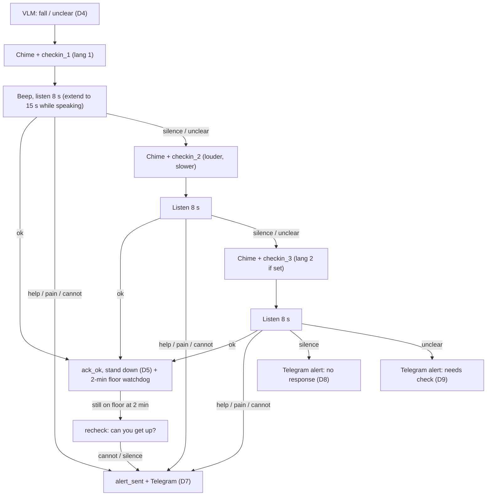
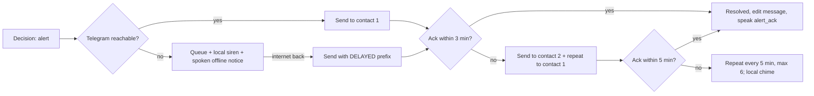
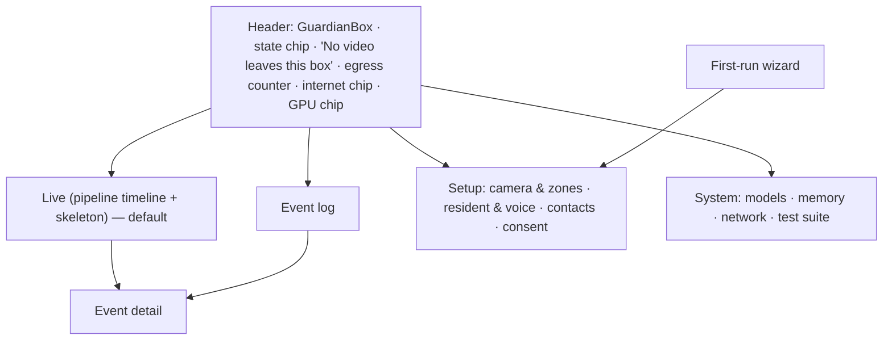
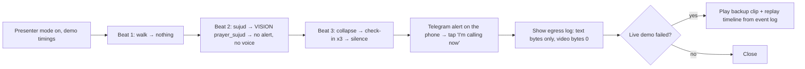

# UX specification — GuardianBox

| Field | Value |
|---|---|
| Owner | Max Saad + team |
| Status | Draft v1.0 — 17 Oct 2026 (Asia/Kuala_Lumpur) |
| Companion | `GuardianBox-PRD.md` (FR IDs, decision table D1–D12, state machine §12, API §15) |
| Surfaces | (a) On-device voice + in-room indicator for the resident · (b) Telegram alerts for family · (c) Local dashboard for setup and the judges' demo |
| Build target | 3-hour hackathon: the dashboard is a single page served by the orchestrator (FastAPI + vanilla JS + SSE). No framework is required. |

---

## 1. Design principles

1. **Watch over, don't watch.** No one sees video in normal use. The dashboard shows a skeleton. The family gets words, not pictures.
2. **Respect first, then safety.** Never speak during a recognised prayer. Accept "I'm fine". Re-check gently only if the person stays down.
3. **Short, warm, clear.** Every spoken prompt is under 5 seconds and tells the person exactly what to say ("cakap 'okey' atau 'tolong'").
4. **When unsure, ask. When there's no answer, tell family.** The design leans toward safety, never toward silence.
5. **Show the machine thinking — for judges and installers.** Every model step is visible with its output, and every byte that leaves the box is counted.

---

## 2. Personas

| Persona | Needs | Design implications |
|---|---|---|
| **Pakcik Ahmad**, 78, Malay, lives alone in Ipoh; mild hearing loss; prays five times a day | Not to be disturbed while praying; help if he falls; no one watching him | Prayer-aware silence; loud, slow Malay prompts; a status light he can understand; a big pause button for when visitors come |
| **Auntie Lim**, 81, Chinese; speaks Hokkien and some Mandarin and English; doesn't use a smartphone | Familiar language; doesn't want "machines talking" constantly | Prompts only on events; family-recorded Mandarin/Hokkien clips; very short answers accepted ("没事", "okay") |
| **Mei**, 45, Auntie Lim's daughter in Singapore; always on Telegram | Clear, fast, trustworthy alerts; few false alarms | Plain-language alert with what happened and what was tried; one-tap "I'm calling now"; escalation to her brother if she doesn't answer |
| **Faiz**, 38, Pakcik Ahmad's son in KL; sets it up | Setup in under 30 minutes; confidence it works | Guided setup with tests at every step; test-alert button; scripted self-test |
| **Kak Ros**, neighbour (contact 2) | Know when to knock on the door | Short escalation message; no app other than Telegram |
| **Judge** | See it is real, local and smart in 5 minutes | Presenter mode: big timeline, GPU panel, egress counter |

---

## 3. Surface (a): on-device voice interaction

### 3.1 Hardware and placement

- USB speakerphone (speaker + mic) on a shelf at chest height, facing the main floor area, within 2–4 m (*design*; real range is measured in PRD M9).
- In-room status indicator: an old tablet/phone in kiosk mode, or a USB LED (see §5).
- Optional large physical USB button: **Pause / Sambung** (pause/resume).

### 3.2 Voice and tone

- **Calm, warm, unhurried, respectful.** Speak as a polite younger relative or carer would. Never robotic urgency, never sirens unless alerting with no internet (D10).
- **Honorific + name** in every first prompt (configured by the family; examples below).
- **Rate:** slightly slow (TTS `speed` ≈ 0.9; family recordings: "speak slowly as if on the phone to them").
- **Volume:** attempt 1 at the configured level; attempt 2 louder (+6 dB, capped) and slower; attempt 3 at the same loud level in the second language.
- **Prompts ≤ 5 s.** Each ends by telling the person what to say.
- **A chime before each prompt** (soft two-tone, 0.5 s). **A short beep** marks "I'm listening now".
- **Mic ignored during playback** (PRD FR-TTS-4).

### 3.3 Honorifics (configured per resident)

| Language | Male elder | Female elder | Family-voice variants (if a child records) | Notes |
|---|---|---|---|---|
| Malay | **Pakcik** (+ name) | **Makcik** (+ name) | **Abah / Ayah**, **Mak / Ibu**, **Tok / Atuk**, **Nenek / Opah** | Pakcik/Makcik are standard respectful terms for older men/women; the family picks |
| English (Malaysian) | **Uncle** (+ name) | **Auntie** (+ name) | **Dad / Pa**, **Mum / Ma** | "Uncle/Auntie" is used across communities in Malaysia |
| Chinese | **阿伯** (Ā bó) / **安哥** (Cantonese-flavoured) | **阿姨** (Ā yí) / **阿嬷**, **婆婆** | **爸 / 妈**, **爷爷 / 奶奶** | Dialect clips (Hokkien/Cantonese) only via family recording (PRD §10.3 gap) |

All scripts below use `{H}` = honorific, `{N}` = name (optional) and `{C}` = first contact's name. **Native-speaker review of every line is a release blocker** (UX open question O1).

### 3.4 Exact check-in scripts

**Malay (Bahasa Melayu)**

| ID | When | Script | Est. duration |
|---|---|---|---|
| `soft` | D3 soft check | "{H} {N}, {H} okey?" | ~2 s |
| `checkin_1` | Attempt 1 | "{H} {N}, {H} okey tak? Kalau perlukan bantuan, cakap 'tolong'." | ~4 s |
| `checkin_2` | Attempt 2 (louder, slower) | "{H} {N}! {H} okey? Cakap 'okey', atau 'tolong'." | ~4 s |
| `checkin_3` | Attempt 3 (or 2nd language) | "{H}, saya nak pastikan {H} selamat. Kalau boleh, jawab 'okey'." | ~4 s |
| `ack_ok` | D5 stand down | "Baik, {H}. Saya ada di sini kalau perlu apa-apa." | ~3 s |
| `recheck` | D6 | "{H}, boleh bangun sendiri? Cakap 'boleh' atau 'tak boleh'." | ~4 s |
| `alert_sent` | D7–D9 | "Saya sudah beritahu {C}. Bantuan akan datang. Jangan paksa diri bangun kalau sakit." | ~5 s |
| `alert_ack` | Family pressed "I'm calling" | "{C} akan telefon {H} sekarang." | ~2 s |
| `offline` | D10 | "Saya sedang cuba hubungi keluarga. Saya akan bunyikan penggera supaya jiran dengar." | ~5 s |

**English (Malaysian English)**

| ID | Script |
|---|---|
| `soft` | "{H} {N}, are you okay?" |
| `checkin_1` | "{H} {N}, are you okay? If you need help, say 'help'." |
| `checkin_2` | "{H} {N}! Are you okay? Say 'okay', or 'help'." |
| `checkin_3` | "{H}, I want to make sure you're safe. If you can, say 'okay'." |
| `ack_ok` | "Okay, {H}. I'm here if you need anything." |
| `recheck` | "{H}, can you get up by yourself? Say 'yes' or 'no'." |
| `alert_sent` | "I've told {C}. Help is coming. Don't force yourself to get up if it hurts." |
| `alert_ack` | "{C} is calling you now." |
| `offline` | "I'm trying to reach your family. I'll sound an alarm so the neighbours can hear." |

**Chinese (Mandarin, Simplified; pinyin for the recorder)**

| ID | Script | Pinyin |
|---|---|---|
| `soft` | "{H}，你还好吗？" | {H}, nǐ hái hǎo ma? |
| `checkin_1` | "{H}，你还好吗？需要帮忙的话，就说"帮忙"。" | {H}, nǐ hái hǎo ma? Xūyào bāngmáng de huà, jiù shuō "bāngmáng". |
| `checkin_2` | "{H}！你还好吗？说"没事"，或者"帮忙"。" | {H}! Nǐ hái hǎo ma? Shuō "méishì", huòzhě "bāngmáng". |
| `checkin_3` | "{H}，我想确定你安全。可以的话，说"没事"。" | {H}, wǒ xiǎng quèdìng nǐ ānquán. Kěyǐ de huà, shuō "méishì". |
| `ack_ok` | "好的，{H}。有需要的话我在这里。" | Hǎo de, {H}. Yǒu xūyào de huà wǒ zài zhèlǐ. |
| `recheck` | "{H}，你自己可以起来吗？说"可以"或者"不可以"。" | {H}, nǐ zìjǐ kěyǐ qǐlái ma? … |
| `alert_sent` | "我已经通知{C}了，有人会来帮你。会痛的话，不要勉强起来。" | Wǒ yǐjīng tōngzhī {C} le, yǒu rén huì lái bāng nǐ. Huì tòng de huà, bùyào miǎnqiǎng qǐlái. |
| `alert_ack` | "{C}现在打电话给你。" | {C} xiànzài dǎ diànhuà gěi nǐ. |
| `offline` | "我正在联系你的家人，我会响警报让邻居听到。" | Wǒ zhèngzài liánxì nǐ de jiārén, wǒ huì xiǎng jǐngbào ràng línjū tīngdào. |

### 3.5 Replies understood (keyword floor + Nemotron classification)

| Intent | Malay | English | Chinese |
|---|---|---|---|
| `ok_no_help` | okey, ok, saya okey, tak apa, takpe, saya sihat, boleh (to recheck) | okay, I'm fine, I'm okay, no problem, yes (to recheck) | 没事, 我没事, 还好, 好, 可以 (to recheck), 无事 (dialect-ish) |
| `needs_help` | tolong, bantu, tolong saya | help, help me | 帮忙, 救命, 帮我 |
| `pain_or_injury` | sakit, sakit kaki/kepala/pinggang, cedera | pain, it hurts, hurt | 痛, 好痛, 受伤 |
| `cannot_get_up` | tak boleh bangun, tak boleh | can't get up, no (to recheck) | 起不来, 不可以 (to recheck) |
| `call_family` | panggil anak saya, telefon {C} | call my son/daughter | 打电话给…, 叫我女儿 |
| `unclear` | anything else, mumbling, VAD speech < 0.3 s | | |

A negation guard runs before "pain" matches ("tak sakit" / "not hurt" / "不痛"). It maps to `unclear` → ask once more → if still unclear, treat as D9 (alert, needs check).

### 3.6 Timing and retries



| Profile | Stillness before VLM | Listen window | Attempts | Fall → alert (silent), approx. |
|---|---|---|---|---|
| **Home** (default) | 10 s | 8 s (max 15) | 3 | ≈ 10 s + VLM + 3 × ~13 s ≈ 55–65 s (*design*, TBM PRD M10) |
| **Demo** (stage) | 3 s | 5 s | 3 | ≈ 3 s + VLM + 3 × ~9 s ≈ 35 s (*design*, TBM) |

### 3.7 Prayer and quiet moments

- D1 (prayer recognised) → **no sound at all**. The kiosk shows "Solat dikesan · tiada amaran" (prayer detected · no alert) in small text for the installer; it is not spoken.
- If a prostration posture lasts > 3 min with no movement (watchdog), use the **soft** prompt first, at normal volume, after a 3-s chime gap.
- Night (22:00–06:00): same volume for checks. A fall at night is exactly when help matters.

---

## 4. Surface (b): family Telegram alerts

### 4.1 Principles

- **Text only, always.** Never photos, video, audio, live links, keypoints or appearance (PRD FR-ALR-3).
- Lead with **who, where, when**, then **what we saw**, **what we tried**, **what you can do**.
- Always say how confident the system is in plain words ("may have fallen", never "has fallen"), and what it **cannot** know.
- Sent in the **contact's** language (en / ms / zh).

### 4.2 Message templates (English shown; Malay and Chinese below)

**A. URGENT — no response (D8)**

```text
🚨 URGENT — Dad may have fallen
Ahmad · Living room · 14:02 (MYT)

What GuardianBox saw: a person lying on the floor near the sofa, not moving.
What it tried: asked 3 times (Malay, English). No reply.

Please call him now. If you can't reach him and think it's an emergency, call 999 or ask a neighbour to check.

Kak Ros (neighbour) will be told in 3 min if no one responds.
— No photos or video are ever sent. All AI runs at home.
```
Buttons (2 rows): `[📞 I'm calling now] [🏃 On my way]` / `[✅ False alarm] [🆘 What to do]`

**B. URGENT — asked for help (D7)**

```text
🚨 URGENT — Mum asked for help
Lim Siew Mei · Living room · 09:41 (MYT)

What GuardianBox saw: a person on the floor after a fall.
What she said: "救命… 好痛" (help… it hurts)

She has been told you're being contacted. Please call her now, or call 999 if you think it's an emergency.
— No photos or video are ever sent.
```

**C. NEEDS CHECK — unclear reply (D9) or can't get up (D6)**

```text
⚠️ Please check on Dad
Ahmad · Living room · 16:20 (MYT)

What GuardianBox saw: a person sitting on the floor for a while.
What happened: he answered, but the reply wasn't clear ("…okey… tak…").
He may need help getting up.

Please give him a call.
```

**D. Delayed (internet was down, D10)** — prefix: `⏱️ DELAYED — sent 14:19, event at 14:02 (internet was down). The local alarm sounded at 14:03.`

**E. Escalation to contact 2 (D11)**

```text
🚨 Ahmad may have fallen — Faiz hasn't responded yet
Living room · 14:02 (MYT) · no reply to 3 check-ins.
Can you check on him? [🏃 I'm going] [📞 I'm calling] [✅ Already handled]
```

**F. System notices (no buttons except "OK")**
- "📷 GuardianBox can't see the living room camera (since 10:15). Monitoring is limited until it's reconnected."
- "⏸️ Monitoring paused by Ahmad until 18:00." (only if the resident agreed to share pauses)
- "✅ GuardianBox restarted and is watching over the living room."

**Malay version of A**

```text
🚨 SEGERA — Abah mungkin terjatuh
Ahmad · Ruang tamu · 14:02 (MYT)

Apa yang dilihat: seseorang terbaring di lantai berhampiran sofa, tidak bergerak.
Apa yang dicuba: ditanya 3 kali (Melayu, Inggeris). Tiada jawapan.

Sila telefon dia sekarang. Jika tidak dapat dihubungi dan anda rasa ini kecemasan, hubungi 999 atau minta jiran periksa.
— Tiada gambar atau video dihantar. Semua AI berjalan di rumah.
```
Buttons: `[📞 Saya telefon sekarang] [🏃 Saya dalam perjalanan] [✅ Amaran palsu] [🆘 Apa perlu buat]`

**Chinese version of A**

```text
🚨 紧急 — 爸爸可能跌倒了
Ahmad · 客厅 · 14:02（马来西亚时间）

看到的情况：有人躺在沙发旁的地上，没有动。
已尝试：问了3次（马来语、英语），没有回应。

请立刻打电话给他。如果联系不上并且觉得情况紧急，请拨打999或请邻居去看看。
— 不会发送任何照片或视频。所有AI都在家里运行。
```
Buttons: `[📞 我现在打电话] [🏃 我在路上] [✅ 误报] [🆘 该怎么做]`

### 4.3 Button behaviour

| Button | Effect | Message update (`editMessageText`) | Spoken in the room |
|---|---|---|---|
| 📞 I'm calling now | Ack; stop escalation | "✔ Faiz is calling (14:03)" appended | `alert_ack`: "Faiz akan telefon Abah sekarang." |
| 🏃 On my way | Ack; stop escalation | "✔ Faiz is on the way (14:03)" | "{C} sedang dalam perjalanan." |
| ✅ False alarm | Ack; resolve; label stored locally | "Marked as false alarm by Faiz" | none |
| 🆘 What to do | Reply with a fixed guidance text (call 999, don't move them if they're hurt, ask a neighbour); **no** auto-dial | — | none |

Callbacks are answered with `answerCallbackQuery` so the button stops spinning (PRD FR-ALR-1). If two contacts press, the first ack wins and the others see "Already handled by Faiz".

### 4.4 What the alert contains — and never contains

| Contains | Never contains |
|---|---|
| Resident's display name, room/zone, local time (MYT) | Photos, video, audio, voice notes, links to media |
| One neutral sentence from the VLM `description` (posture + location) | Clothing, body or face descriptions; "unconscious" or other diagnoses |
| Check-in result + a short quote (≤ 60 chars, if transcripts are enabled) | Full transcripts, keypoints, confidence decimals |
| What happens next (escalation timing) | Home address (unless the family opts in for the neighbour message) |
| "No photos or video are sent" footer | Anything during a recognised prayer (no message is sent) |

### 4.5 Alert lifecycle



---

## 5. In-room status indicator (for the resident)

A kiosk screen (old tablet or phone, browser in full-screen) or a USB LED near the speakerphone. The kiosk is optional for the hackathon, but it is the resident's main window into the system and the main thing that makes it trustworthy.

```text
┌──────────────────────────────────────────┐
│        🟢  GuardianBox aktif              │
│   Video kekal di rumah ini. Tiada siapa   │
│   menonton. Hanya mesej teks jika perlu.  │
│                                           │
│   ┌───────────────────────────────────┐   │
│   │      ⏸  JEDA 1 JAM (Pause 1 h)     │   │
│   └───────────────────────────────────┘   │
│          Bahasa: [BM] [EN] [中文]          │
└──────────────────────────────────────────┘
```

| State | Light/screen | Copy (ms / en / zh) |
|---|---|---|
| Monitoring | Steady green | "GuardianBox aktif" / "GuardianBox is on" / "GuardianBox 运行中" + privacy line |
| Checking in | Pulsing amber + large text of the prompt (for hard of hearing) | Text of the current prompt, e.g. "Pakcik okey tak? Cakap 'okey' atau 'tolong'." |
| Alert sent | Steady blue | "Keluarga sudah diberitahu" / "Family has been told" / "已通知家人" |
| Paused | Grey + countdown | "Dijeda hingga 18:00" / "Paused until 18:00" / "暂停至18:00" + [Sambung / Resume / 继续] |
| No internet | Green + small cloud-off icon | "Masih menjaga. Internet terputus — amaran akan dihantar bila sambung semula." |
| Camera lost | Red outline | "Kamera tidak dapat melihat. Sila semak sambungan." |

Text ≥ 32 px, contrast ≥ 7:1 (*design*, above AA for older eyes), and one large button only. No touch gestures beyond a tap.

---

## 6. Surface (c): local dashboard

### 6.1 Information architecture



Pages: `/setup` (wizard), `/live`, `/events`, `/events/{id}`, `/settings/camera`, `/settings/resident`, `/settings/contacts`, `/settings/consent`, `/system`, `/system/tests`. **Presenter mode** (toggle in the header) enlarges the timeline and GPU panel for the projector and enables the demo controls.

### 6.2 Global header (every screen)

```text
┌──────────────────────────────────────────────────────────────────────────────────────────────┐
│ ◉ GuardianBox  ● MONITORING   🔒 No video leaves this box   ↑ Egress today: 3 msgs · 2.1 KB  │
│ (Live) (Events) (Setup) (System)          🌐 Internet OK   ▤ ATOM 74/128 GB · GPU 18%   [⏻ Presenter] │
└──────────────────────────────────────────────────────────────────────────────────────────────┘
```

| Element | States |
|---|---|
| State chip | MONITORING (green) · SUSPECTED / CONFIRMING / CHECKING-IN (amber, pulsing) · ALERTING / AWAITING ACK (red) · RESOLVED (blue) · PAUSED (grey) · CAMERA LOST (red outline) · DEGRADED (amber: a model is down) |
| Privacy banner | Always shown. Tooltip: "Frames stay in memory on this DGX Spark and are deleted after each check. Only text alerts go to Telegram." |
| Egress counter | Messages and bytes sent today to `api.telegram.org`, plus `Image/video bytes out: 0` in the drawer. Any blocked egress attempt shows a red badge (it should never happen) |
| Internet chip | OK · DOWN ("alerts will queue; local alarm on") · SIMULATED DOWN (presenter mode) |
| GPU chip | Unified memory used/total + GPU util; opens the GPU panel |

### 6.3 S1 — First-run wizard (`/setup`)

Steps: **1 Welcome & consent → 2 Camera → 3 Zones → 4 Resident & languages → 5 Voice clips → 6 Family contacts → 7 Test → Done.**

```text
┌ Set up GuardianBox ─────────────────────────── Step 1 of 7 · Consent ┐
│ GuardianBox watches over {Resident} in the living area.               │
│  ✓ Video stays on this box and is never saved or sent.                │
│  ✓ Family get a short text message only if {Resident} may need help.  │
│  ✓ {Resident} can pause it any time with the big button.              │
│  ✗ It does not cover the bathroom. It is not a medical device.        │
│                                                                       │
│ Explained to {Resident} in: (•) Bahasa Melayu ( ) English ( ) 中文     │
│ [▶ Play explanation aloud]                                            │
│ ☐ {Resident} agrees to be monitored in these rooms                     │
│ ☐ Store short reply quotes in the log (optional)                       │
│ ☐ Tell family when monitoring is paused (optional)                     │
│ Consent given by: (•) {Resident} ( ) Legal representative  Witness: [ ]│
│                                                    [Back] [Continue →]│
└───────────────────────────────────────────────────────────────────────┘
```

- Continue is disabled until the first checkbox is ticked. The consent record is saved with a timestamp (PRD ConsentRecord).
- "Play explanation aloud" uses the clip voice so the resident hears the system before it is ever used.

### 6.4 S2 — Camera & zones (`/settings/camera`)

```text
┌ Camera & zones ──────────────────────────── 🔴 LIVE VIDEO (setup only) · auto-off 4:12 ┐
│ Source: (•) USB /dev/video0 ( ) RTSP [rtsp://…]   Resolution 1280×720 · 12 fps        │
│ ┌──────────────────────────────────────────────┐  Zones                               │
│ │  live preview with drawn polygons             │  ▣ Floor (blue)        [Draw]       │
│ │   ┌──sofa/bed──┐     ┌prayer area┐            │  ▣ Sofa / bed (purple)  [Draw]      │
│ │   └────────────┘     └───────────┘            │  ▣ Prayer area (green)  [Draw]      │
│ │  ───────── floor line ─────────               │  ▣ Chair (grey)         [Draw]      │
│ └──────────────────────────────────────────────┘  ▣ Ignore (TV, window)  [Draw]      │
│ [Switch to skeleton view]   Tips: chest-to-head height, see the whole floor,        │
│ avoid pointing at windows (glare).        [Test: walk across the room ▶]            │
└───────────────────────────────────────────────────────────────────────────────────────┘
```

| State | UI |
|---|---|
| Empty (no camera) | "No camera found. Plug in a USB webcam or enter an RTSP address." [Rescan] |
| Loading | "Connecting to camera…" spinner (≤ 10 s) |
| Error | "Can't open /dev/video0 — it may be used by another app." / "RTSP: wrong password or address." [Retry] |
| Camera lost | Red frame: "No picture for 12 s. Check the cable or power." The header chip shows CAMERA LOST |
| Pose not loaded | "Pose model is starting (first start builds a TensorRT engine; this can take a few minutes)." Duration TBM |
| Live-preview timeout | After 5 min the view switches to the skeleton automatically with a notice (PRD FR-PRIV-3) |

The prayer area is optional. The tooltip: "If someone in the home prays here, mark it. GuardianBox still checks, but will understand prayer movements."

### 6.5 S3 — Resident & voice (`/settings/resident`)

```text
┌ Resident & voice ───────────────────────────────────────────────────────────┐
│ Name [Ahmad      ]  Call them: [Pakcik ▾] (Pakcik/Makcik/Uncle/Auntie/阿伯/…/custom) │
│ Languages, in order: [1 Bahasa Melayu ▾] [2 English ▾] [3 — ▾]              │
│ Hearing: ( ) Normal (•) Louder   Prays at home: ☑ (adds prayer context)     │
│ ┌ Check-in clips ───────────────────────────────────────────────────────┐   │
│ │ Phrase       BM                    EN                 中文              │   │
│ │ checkin_1    ● Recorded by Faiz ▶  ◐ Generated ▶      — not needed     │   │
│ │ checkin_2    ● Recorded ▶          ◐ Generated ▶                       │   │
│ │ checkin_3    ○ Missing [🎙 Record] [⚙ Generate]                         │   │
│ │ ack_ok …                                                               │   │
│ └────────────────────────────────────────────────────────────────────────┘   │
│ [🎙 Record all in BM (guided)]  [▶ Play full check-in]  Volume ▮▮▮▮▮▯ [Test]  │
└─────────────────────────────────────────────────────────────────────────────┘
```

- **Guided recording:** shows each script line (from §3.4) with the name filled in, a 3-2-1 countdown, a 6 s max, playback, and re-record. The voice is a family member's ("Speak slowly, like on the phone to them").
- **Generate:** English via Kokoro. Malay via a setup-time generator if installed (PRD §10.4), with a warning: "Generated Malay voice may mispronounce words. A family recording is recommended."
- Validation: every phrase in language 1 must exist before arming. Missing clips are listed.

### 6.6 S4 — Family contacts (`/settings/contacts`)

```text
┌ Family contacts (Telegram) ─────────────────────────────────────────────┐
│ 1. Faiz (son)      ✓ connected   Language EN   [Send test alert] [Edit] │
│ 2. Kak Ros (jiran) ✓ connected   Language BM   [Send test alert] [Edit] │
│ [+ Add contact]  How: open t.me/<YourGuardianBoxBot>, press Start, enter code 4821 │
│ Escalate to contact 2 after [3 ▾] min without a reply                    │
└──────────────────────────────────────────────────────────────────────────┘
```

| State | Copy |
|---|---|
| Empty | "Add at least one family member. They'll get text alerts on Telegram — never photos or video." |
| Waiting for Start | "Waiting for Faiz to press Start in Telegram… (code 4821)" |
| Test sent | "Test alert delivered at 14:31. Ask Faiz to tap a button to check." Then "✔ Faiz tapped 'I'm calling now'." |
| Internet down | "Can't reach Telegram. Contacts can be added when the internet is back." |
| Bot token invalid | "Telegram rejected the bot token. Check it in System → Network." |

### 6.7 S5 — Live view: pipeline timeline (`/live`) — the demo centrepiece

```text
┌ Live ─────────────────────────────────────────────────────────────────────────────────────────┐
│ ┌ Skeleton view (no video) ─────────────┐ ┌ Pipeline timeline ─────────────────────────────────┐ │
│ │        o                              │ │ 14:02:01 [POSE · YOLO26n-pose]  fast descent 0.6 s, │ │
│ │       /|\        sofa                 │ │          torso 78°, still 3 s → SUSPECTED   8 ms/f   │ │
│ │       / \     ┌──────┐                │ │ 14:02:02 [VISION · Nemotron Omni] 2×2 frames →       │ │
│ │  ─────────────floor───────────        │ │          {"scene_class":"fall","conf":0.86,…} 3.1 s* │ │
│ │  zone: floor · torso 78° · still 4 s  │ │ 14:02:05 [AGENT · Nemotron Omni] decide → check-in   │ │
│ └───────────────────────────────────────┘ │          tool: speak(checkin_1, ms)                  │ │
│ ┌ Event ────────────────────────────────┐ │ 14:02:06 [VOICE] ▶ "Pakcik Ahmad, Pakcik okey tak?…" │ │
│ │ State: CHECKING-IN  attempt 2/3        │ │ 14:02:10 [STT · Malaysian Whisper] listening 8 s ◌    │ │
│ │ Next: listen 8 s, then attempt 3 (EN)  │ │          → no speech                                 │ │
│ │ [Simulate reply ▾] (presenter only)    │ │ 14:02:19 [VOICE] ▶ checkin_2 (louder)                 │ │
│ └───────────────────────────────────────┘ │ … [ALERT · Telegram] sent to Faiz · 812 B text only*  │ │
│ ┌ ATOM panel ───────────────────────────┐ │ [Expand JSON] [Export event.json]                     │ │
│ │ Memory 74/128 GB ████████░░░          │ └──────────────────────────────────────────────────────┘ │
│ │ GPU 18% · vLLM: 0 running, 0 waiting   │  * numbers in wireframes are placeholders; the UI shows  │
│ │ ● Nemotron Omni (vLLM) ~45 GB resident │    live measured values only                            │
│ │ ● YOLO26n-pose · ● Whisper · ● Kokoro  │                                                         │
│ │ Video bytes out: 0                     │                                                         │
│ └───────────────────────────────────────┘                                                         │
└────────────────────────────────────────────────────────────────────────────────────────────────┘
```

**Timeline row anatomy:** time (MYT) · **role chip** · model · input type (frames/audio/text) · key output (class + confidence, transcript, intent, decision row) · latency · status. Expanding a row shows the full JSON / tool call (secrets redacted).

| Role chip | Model | Colour + icon |
|---|---|---|
| POSE | YOLO26n-pose | teal · skeleton icon |
| VISION | Nemotron Omni (image) | violet · eye |
| AGENT | Nemotron Omni (tools) | indigo · branching arrows |
| VOICE | Clips / Kokoro | orange · speaker |
| STT | Malaysian Whisper | green · mic |
| ALERT | Telegram (text) | red · paper plane |
| SYSTEM | Orchestrator | grey · gear |

The header line above the timeline is computed, not hard-coded: "5 AI roles · 4 models on this ATOM · 0 cloud AI calls".

**Prayer moment (Beat 2)** renders as a calm card, not a red one:

```text
14:05:33 [POSE] low posture ×3 cycles in 40 s → SUSPECTED
14:05:34 [VISION · Nemotron Omni] "prayer_sujud" · on prayer area · conf shown live
14:05:34 [AGENT] D1: prayer recognised → no alert, no voice · watchdog 3 min
```

| State | UI |
|---|---|
| Empty (no events yet) | "All quiet. GuardianBox is watching the living room. Events will appear here." |
| Model not loaded | Row placeholder: "Nemotron is loading (can take 10+ minutes on first start). Until it's ready, any fall goes straight to a voice check-in." Header chip DEGRADED |
| STT down | "Speech recognition is offline — any check-in will be treated as 'no reply' and family will be alerted." |
| Camera lost | Skeleton pane greyed: "Camera lost 00:00:12". Timeline SYSTEM row |
| Internet down | Banner: "Internet down — alerts will queue and the local alarm will sound. Detection and voice check-ins still work." |
| Error (orchestrator unreachable) | "Dashboard lost connection to GuardianBox. Retrying…" (SSE reconnect with last event id) |

### 6.8 S6 — Event log and detail (`/events`, `/events/{id}`)

```text
┌ Events ──────────────── Filter: [All ▾] [Last 7 days ▾] ──────────────── [Export CSV] ┐
│ 17 Oct 14:02  🚨 Fall · no reply → alert · ack by Faiz (1 min)         [Open]         │
│ 17 Oct 13:15  🕌 Prayer recognised · no alert                           [Open]         │
│ 17 Oct 11:40  🪴 Floor work (gardening) · no alert                      [Open]         │
│ 16 Oct 21:08  ✅ Fall? · "Saya okey" · stood down · got up in 40 s      [Open]         │
│ 16 Oct 09:00  📷 Camera lost 4 min                                      [Open]         │
└───────────────────────────────────────────────────────────────────────────────────────┘
```

Detail: timeline replay (same rows as Live), VLM JSON, check-in attempts with transcripts (if enabled), decision row (D1–D12) with the rule text, alerts and acks, latency per stage. **No images.** Buttons: [Mark as false alarm] (local label), [Export event.json], [Delete event].

Empty state: "No events yet. That's good news." Retention notice: "Events are kept 90 days on this box."

### 6.9 S7 — System (`/system`, `/system/tests`)

- **Models:** each service with status (Ready / Loading / Down), memory, last latency, [Restart]. Admin-only [Flush page cache] with a confirmation that shows the exact command (PRD §13).
- **Network:** egress allowlist (`api.telegram.org`), log of every outbound request (time, method, bytes), "Simulate internet down" (presenter mode).
- **Tests:** a run sheet for F1–F8 / T1–T8 (PRD §21) with [Start trial], live expected-vs-actual, and the results table exported to `tests/scenarios/results.csv` for the README.

### 6.10 Dashboard state coverage summary

| Screen | Empty | Loading | Error | Camera lost | Model not loaded | Internet down |
|---|---|---|---|---|---|---|
| Live | "All quiet…" | skeleton spinner | SSE reconnect banner | greyed skeleton + timer | DEGRADED chip + fail-safe note | banner + queued alerts count |
| Camera & zones | "No camera found" | "Connecting…" | device/RTSP errors | red frame | pose loading note | n/a |
| Resident & voice | "Add a name and language" | clip generation progress | "Couldn't generate — record instead" | n/a | "Voice engine starting" | n/a (all local) |
| Contacts | "Add at least one…" | "Waiting for Start" | bad token | n/a | n/a | "Can't reach Telegram" |
| Events | "No events yet" | skeleton rows | "Couldn't load log" | camera-lost events listed | n/a | delayed alerts marked ⏱️ |
| System | — | per-service spinners | per-service error + [Restart] | — | Loading with elapsed time | network panel red |

---

## 7. Key flows

### 7.1 Setup (installer)

```mermaid
flowchart LR
  A["Open dashboard on LAN"] --> B["Consent, explained aloud"]
  B --> C["Camera + live preview (setup only)"]
  C --> D["Draw zones: floor, sofa, prayer area"]
  D --> E["Resident: honorific, languages, hearing"]
  E --> F["Record or generate clips"]
  F --> G["Add Telegram contacts + test alert"]
  G --> H["Self-test: walk, sit, safe mat fall"]
  H --> I["Arm monitoring; kiosk shows GuardianBox aktif"]
```



### 7.2 Judges' demo (presenter mode)



---

## 8. Accessibility

**For the elderly resident (voice + kiosk)**
- Short prompts that end with the exact words to say. A small set of accepted answers (§3.5).
- Louder, slower second attempt. Third attempt in the second language. A chime first to get attention.
- Hearing-impaired: the kiosk shows the prompt text in large type while it is spoken; a flashing screen border during check-in (P1: a lamp via a smart plug, local only).
- Visual impairment: no reliance on the screen. Everything important is spoken.
- Cognitive load: never more than one question at a time. No menus by voice. Reassuring confirmation after every outcome ("Saya sudah beritahu Faiz").
- Physical: the pause button is large (≥ 15 cm² on the kiosk, or a physical USB button). No fine gestures.
- Respect: no talking during prayer; no "test" announcements without warning.

**For family (Telegram)**
- Plain words, emoji used only as level markers (🚨 ⚠️ ⏱️), never as the only signal: the level word is always written.
- The message is understandable without opening anything else.

**Dashboard (WCAG 2.2 AA)**
- Contrast ≥ 4.5:1. Role chips use icon + text + colour. Status is never conveyed by colour alone.
- Keyboard-reachable controls, visible focus, `aria-live="polite"` on the timeline (announces state changes, not every pose frame).
- `prefers-reduced-motion` disables pulsing chips.
- Presenter mode: text ×1.5 for the projector.

## 9. Responsive behaviour

| Width | Layout |
|---|---|
| ≥ 1440 px (projector) | Skeleton + timeline + ATOM panel side by side (as the wireframe) |
| 1024–1439 px | Timeline full width; skeleton and ATOM panel as a collapsible right column |
| < 1024 px (family phone over Tailscale, P1) | Read-only status + event log + acknowledge buttons; no live skeleton by default |
| Kiosk (any tablet) | Fixed single-screen layout (§5), portrait or landscape |

## 10. Edge cases

| Case | Behaviour | UX |
|---|---|---|
| Visitor in the room (two people) | VLM may return `no_person_or_unclear`; check-in still asked if a fall is suspected | Kiosk "Visitor mode" = pause 2 h; Telegram never says who |
| Pet on the floor | Pose detects no person → nothing; VLM `no_person_or_unclear` → soft check | — |
| Resident says "okey" but stays down | D6 re-check at 2 min | `recheck` prompt |
| Resident replies in an unexpected language (e.g. Tamil, Hokkien) | STT may mis-transcribe → `unclear` → one more try → D9 alert | Alert says "reply wasn't clear" |
| Loud TV during check-in | VAD may detect speech; keyword floor + LLM likely `unclear` | Prompt: "Kalau boleh, perlahankan TV…" (P1); alert if unclear |
| Collapse during prayer | D1 → watchdog → soft prompt → full check-in | No interruption for the first 3 min (*design*; review with users) |
| Internet down | D10 | Siren + spoken notice; dashboard banner; DELAYED alert later |
| Power cut | Box off; nothing works | Boot message "GuardianBox restarted"; UPS recommended (stated honestly) |
| Model not loaded at a fall | VLM skipped → check-in (fail-safe) | Timeline: "VISION unavailable — asked directly" |
| Camera knocked out of position | Pose sees no floor/person for long | "Camera may have moved" notice after 30 min of no person (P1) |
| Family taps "False alarm" on a real fall | Event resolved by their choice; labelled locally | Telegram reply: "Marked as false alarm. If you're unsure, please call to check." |

## 11. Microcopy

| Context | Copy |
|---|---|
| Product line (dashboard header tooltip) | "GuardianBox — watching over, without watching." |
| Privacy banner | "No video leaves this box." |
| Egress drawer | "Only text alerts go out, to Telegram. Image and video bytes sent: 0." |
| Live empty | "All quiet. GuardianBox is watching the living room." |
| Prayer card | "Prayer recognised — no alert, no voice." |
| Check-in in progress | "Asking {H} {N} if they're okay (attempt 2 of 3)…" |
| Alert sent | "Alert sent to {C}. Waiting for a reply." |
| Ack | "{C} is calling (14:03)." |
| Model loading | "Nemotron is warming up. Falls will still get a voice check-in." |
| Internet down | "Internet down — still watching. Alerts will queue and the alarm will sound." |
| Pause (kiosk, ms) | "Jeda 1 jam" · resume "Sambung" |
| Consent footer | "GuardianBox is not a medical device and does not replace emergency services. In an emergency, call 999." |
| Arming blocked | "Add at least one family contact and record the first check-in before turning GuardianBox on." |

## 12. Open UX questions

| ID | Question |
|---|---|
| O1 | Native-speaker review (Malay, Mandarin) of every script line, including politeness level and the choice of honorifics |
| O2 | Familiar family voice vs neutral voice for prompts: comforting, or confusing for someone disoriented? Test with real users |
| O3 | Is 3 minutes the right prayer watchdog? Discuss with Muslim elders/carers |
| O4 | Should family see a daily "all fine" summary, or does that feel like surveillance? (Resident decides) |
| O5 | Siren loudness and tone during an internet outage: helpful to neighbours, or frightening to the resident? |

## 13. Traceability to the PRD

| UX element | PRD reference |
|---|---|
| Check-in scripts, timing, retries | FR-TTS-1..4, FR-STT-1..4, decision table D3–D9 |
| Prayer silence + watchdog | FR-POSE-5/6, FR-VLM-3/4, FR-EVT-3, D1 |
| Telegram templates + buttons | FR-ALR-1..5, FR-ALR-7, D7–D11 |
| Text-only rule + egress counter | FR-ALR-3, FR-PRIV-1, NFR-1 |
| Skeleton-only live view, setup-only live video | FR-PRIV-3 |
| Kiosk + pause | FR-PRIV-4/5 |
| Pipeline timeline + role chips | FR-AGT-1, FR-LOG-1, scorecard "AI capability" |
| ATOM panel | FR (metrics) §15 `/metrics`, §13 memory budget |
| Internet-down states | FR-ALR-5, D10 |
| Test runner | PRD §21 |
| Demo flow | PRD §24 |

